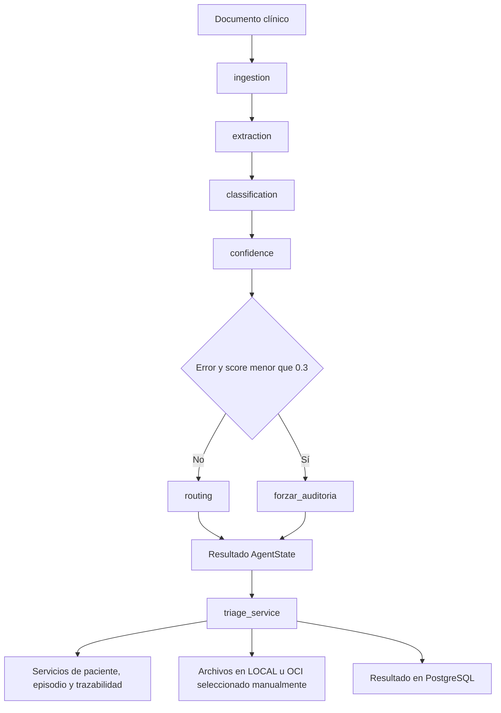

# Guía de LangGraph en MediFlow

## Propósito y alcance

El grafo analiza un documento clínico y devuelve un `AgentState` con extracción,
clasificación, confianza y decisión de enrutamiento. No equivale a una validación
médica del diagnóstico. PostgreSQL sigue siendo la fuente de verdad de los datos
persistidos y la intervención humana se realiza mediante los endpoints HITL.

Esta guía describe el código integrado desde `develop` en `b175a3f` y las
correcciones locales de integración del catálogo, conservación del estado y
trazabilidad del terminal de error. No cambia umbrales ni precedencias clínicas.

## Recorrido



Los cinco nodos principales son `ingestion`, `extraction`, `classification`,
`confidence` y `routing`. `forzar_auditoria` es el terminal excepcional que ya
existía para errores críticos; no procesa otro análisis clínico.

| Nodo | Responsabilidad | Salida principal |
| --- | --- | --- |
| `ingestion` | Texto directo, lectura PDF y OCR Tesseract en español para imágenes o PDF sin texto | `texto_extraido`, errores |
| `extraction` | Extraer entidades por bloques, validar CIE-10 y cotejar identificadores de paciente | `datos_extraidos`, `metadata` |
| `classification` | Clasificar bloques y consolidar su prioridad usando el catálogo canónico | `clasificacion` |
| `confidence` | Ajustar el score con las señales ya implementadas, conservando los demás campos | `clasificacion` copiada |
| `routing` | Resolver destino, revisión humana y notificación usando los resultados anteriores | `decision_enrutamiento`, `status` |
| `forzar_auditoria` | Terminar ante el error crítico definido por la arista condicional | Auditoría humana y traza del terminal |

## Estado compartido y actualizaciones

`backend/app/agent/state.py` define los modelos Pydantic que viajan por el grafo.
Cada nodo devuelve un diccionario con los campos que actualiza; los campos no
incluidos permanecen en el estado gestionado por LangGraph.

Los nodos añaden su nombre a `nodos_ejecutados`. El terminal de error también
registra `forzar_auditoria`, permitiendo distinguirlo de un recorrido que pasó
por `routing`. Esta lista describe ejecución en memoria; no sustituye los eventos
persistidos en PostgreSQL.

Para cambiar solo la confianza, se copia la clasificación con
`model_copy(update={...})`. Así se conserva también `categoria_documento`, campo
de compatibilidad, sin mutar el objeto recibido.

Se conserva el cálculo de confianza incorporado por el equipo, con desglose en
`metadata.factores_confianza`, umbral HITL de 0.75 y restricción del score al
intervalo [0.0, 1.0]. La resolución de conflictos de actualización no sustituye
ese cálculo por la versión anterior.

Los tipos de documento se normalizan mediante `normalizar_tipo_documento()`.
El valor canónico de receta es `Receta Médica`; el enrutamiento también reconoce
variaciones legadas como `Receta_Medica`, usando el mismo catálogo.

## Datos CIE-10 y paciente

El nodo de extracción conserva `diagnostico_principal` y valida la sugerencia
CIE-10 contra el índice versionado. El código normalizado se guarda en
`cie10_sugerido` y su etiqueta en `cie10_descripcion`. La pertenencia al catálogo
no demuestra correspondencia clínica con el paciente.

Las sugerencias inválidas se retiran del campo clínico y se conservan en
`metadata.cie10_codigos_invalidos`. La consolidación por bloques mantiene esta
señal aunque otro bloque produzca un código válido. La ausencia de código no
activa esa señal por sí sola.

Cuando hay datos de paciente, `patient_matcher` coteja DNI e historia clínica.
Los conflictos marcan `discrepancia_identidad_detectada` y su motivo. El servicio
de triaje vuelve a resolver los identificadores antes de persistir y puede
ajustar el destino por conflicto. El grafo y el servicio no son la misma capa.

## Enrutamiento actual

Esta tabla documenta el comportamiento existente; no establece nuevas reglas
clínicas. Las condiciones se evalúan en el orden indicado.

| Orden | Condición | Comportamiento |
| --- | --- | --- |
| Antes de routing | Hay `error_mensaje` y score menor que 0.3 | Terminal `forzar_auditoria` y `pendiente_auditoria` |
| 1 | Discrepancia de identidad | `Cola_Revision_Ambigua`, revisión humana |
| 2 | Prioridad `Ambiguo` | `Cola_Revision_Ambigua`, revisión humana |
| 3 | Prioridad `Urgente` | `Cola_Emergencia_Medica`, notificación |
| 4 | Score menor que 0.75 | `Cola_Auditoria_Humana`, revisión humana |
| 5 | Receta o condición de farmacoterapia ya implementada | `Farmacia_Hospitalaria`; la bandera de controlados obliga a revisión en esta rama |
| 6 | Resto de casos | `Cola_Rutina` |
| Después del cálculo | Hay códigos CIE-10 inválidos | Sobrescribe destino a `Cola_Auditoria_Humana`, exige revisión y retira notificación |

`status` es `pendiente_auditoria` cuando se requiere intervención humana y
`procesado` en los demás casos. Los umbrales y ajustes de confianza son
heurísticos; no se modificaron ni se acreditó calibración clínica.

### Puntos que requieren decisión clínica antes de ampliarse

- Actualmente la urgencia se evalúa antes de farmacia; la bandera de controlados
  no se evalúa dentro de esa rama de emergencia. Cambiarlo requiere definir una
  política explícita de urgencia e HITL.
- La señal de CIE-10 inválido puede sobrescribir un destino previo de emergencia
  o conflicto. El servicio puede volver a aplicar la revisión por identidad.
- `medicamentos_controlados` se consume desde los metadatos. No se implementó
  aquí un detector farmacológico ni un catálogo de medicamentos.

## Frontera con persistencia y episodios

`ejecutar_triage()` ejecuta el grafo y mide `tiempo_procesamiento_ms`. Ese tiempo
incluye el grafo y su construcción; no mide todas las escrituras posteriores del
servicio ni garantiza un SLA extremo a extremo.

`TriageService.procesar_documento()` coordina el resultado con pacientes,
episodios, archivos y PostgreSQL. La versión de base ya incorpora creación o
asociación de episodio cuando hay un paciente identificado, y eventos de
trazabilidad. No se reconstruyó ni se modificó esa funcionalidad en esta entrega.

La orquestación de episodios se ejecuta antes de guardar el resultado del
documento. No comparte una transacción única con ese guardado. La verificación
de vinculación real del documento en el evento, reintentos y concurrencia sigue
siendo trabajo de integración de persistencia, independiente de estas
correcciones del grafo. No se presenta como garantizado por las pruebas simuladas.

## Pruebas y ejecución local

Desde `backend/`, usando el entorno virtual de la raíz del repositorio:

```powershell
..\.venv\Scripts\python.exe -m pytest tests/test_langgraph_integration.py tests/test_agent_cases.py tests/test_cie10_extraction.py tests/test_destinos_triaje_unit.py -v
```

La suite nueva usa un LLM simulado y documentos sintéticos. Comprueba el recorrido
completo para recetas canónicas y legadas, controlados, urgencia, rutina,
ambigüedad e identidad conflictiva; también conserva CIE-10 y el diagnóstico,
comprueba que los metadatos de entrada no se mutan y verifica el terminal de
error. Las pruebas de confianza aseguran que solo cambie el score.

`tests/conftest.py` aísla archivos en directorios temporales, fuerza el LLM
simulado y deshabilita conexiones a la base de desarrollo. Las pruebas de
PostgreSQL real de BD-04 y API-04 requieren sus sandboxes explícitos y no quedan
acreditadas cuando se omiten.

Antes de publicar, comprobar la suite backend completa, `vitest run`,
`npm run build`, `generate.py --check` y `alembic upgrade head --sql`. Las pruebas
de flujo con mocks no sustituyen una comprobación de persistencia real aislada.

## Verificación previa y actualización de la base

Los resultados siguientes corresponden al trabajo local anterior sobre `b9ccb48`;
no constituyen una verificación completa del nuevo `develop` en `b175a3f`.

- Agente: 43 pruebas pasando, incluidas las 12 nuevas regresiones de integración.
- Suite backend completa: 375 pruebas pasando y 101 omitidas; no se activaron los
  sandboxes de PostgreSQL real.
- Ruff y formato de los archivos Python modificados: correctos.
- Base `b9ccb48`, antes de estas correcciones: build frontend y SQL Alembic offline
  correctos; frontend con 62 pruebas pasando y 5 fallos de login/registro.
- La base también presenta modelos generados desactualizados y seis advertencias
  de OpenAPI en coordinación. No se modificaron esos contratos ni el frontend.

Los cambios del grafo están comprobados localmente, pero la validación global del
proyecto sigue pendiente por esos problemas de base. No se acredita una entrega
completa en verde ni persistencia E2E real, y no se publicaron estos cambios.

## Estado posterior: IA-08 sobre develop b175a3f

El 14 de octubre de 2026 se verificó el árbol local con IA-08: 435 pruebas backend
aprobadas y 101 omitidas; 64 frontend aprobadas; build y Alembic offline correctos.
Los fallos de frontend históricos descritos arriba no se reproducen en esta base.
Los tipos se regeneraron y coinciden con OpenAPI; se mantienen seis advertencias
preexistentes de coordinación. IA-08 también se comprobó con PostgreSQL 17.11,
login y SSE reales en una base desechable: persistencia confirmada desde otra
conexión, envío a los tres roles autorizados y ausencia de emisión ante un fallo
real de INSERT. Se añadió la migración `r1s111855no7` porque el enum de roles no
incluía MEDICO. No se aplicó esta migración en `mediflow_dev`. Las integraciones
omitidas de otras tareas conservan sus requisitos de sandbox y no se acreditan.

`routing` prepara una notificación genérica para emergencias. `TriageService`
solo la despacha si el destino definitivo sigue siendo emergencia, después de
persistir documento y evento. La [guía IA-08](IA-08_ALERTAS_GUARDIA_SSE.md) detalla
permisos, contenido mínimo, endpoint SSE y límites operativos. Esta validación
local es previa a la publicación para revisión y no acredita un despliegue.
