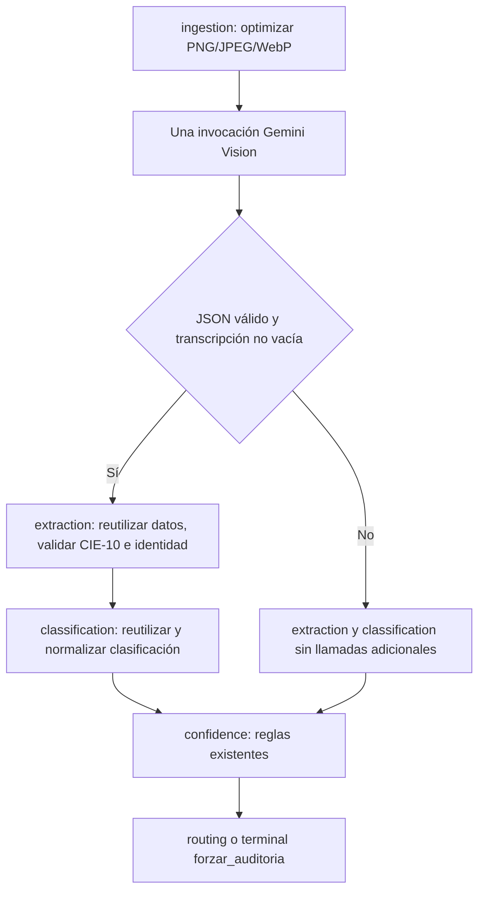

# IA-09: Pipeline Fusion — trabajo local

Referencia: [Issue #69](https://github.com/No-Country-simulation/G10-LATAM-TEAM-02-MediFlowI-Agente-IA/issues/69).

## Estado y alcance

La primera implementación se preparó sobre `9ef29a1`, después de IA-08. El 16 de
octubre de 2026 se respaldó y se integró en local sobre `develop` **482da50**,
que ya incluye los PR aceptados. IA-09 sigue sin commits propios ni publicación.
La [comparación de develop](IA-09_COMPARACION_DEVELOP_20261016.md) explica los
aportes conservados, conflictos resueltos y la validación de esta integración.

La fusión se aplica a documentos `IMAGEN` en PNG/JPEG/WebP. Transcripción, extracción
y clasificación se solicitan en un solo `ainvoke` de Gemini Vision. Se mantienen
los cinco nodos LangGraph, las reglas de confianza, CIE-10, identidad y routing.
Texto y PDF conservan el procesamiento de develop, incluido Vision y OCR de
respaldo para PDF escaneado. No se acredita un pase único para PDF escaneado ni
para documentos de texto divididos en varios bloques.

Decisiones confirmadas por el usuario:

- Trabajar únicamente en local hasta revisar la integración de los PR previos.
- Si falla la fusión o su respuesta es inválida, derivar a revisión humana sin
  ejecutar otra ronda de extracción/clasificación ni fallback OCR.
- Medir el grafo completo con Gemini real, 20 imágenes clínicas sintéticas,
  e informar p50, p95 y máximo. El criterio acordado es **p95 < 8 segundos**.
- Usar razonamiento `low` exclusivamente en Fusion con Gemini 3, comprobando
  que se conserven los datos explícitos y las decisiones de los casos sintéticos.

## Flujo



`ContextoTriaje` es un contexto de ejecución por solicitud. Contiene el cliente
LLM y la respuesta validada durante los nodos que la necesitan. No procede de
`metadata` ni se serializa en `AgentState`. Una petición no puede inyectar una
respuesta de fusión mediante metadatos. El resultado temporal se libera después
de clasificación. El grafo compilado se reutiliza con `functools.cache` y no
captura clientes ni datos de pacientes en sus clausuras. La concurrencia usa
contextos separados, con pruebas para códigos CIE-10 distintos en dos solicitudes.

`documento_base64` se devuelve como `None` al terminar ingesta, también ante
errores. Esto evita propagar el binario por los nodos y el resultado JSON; no
promete eliminar todas sus copias de RAM. `TriageService` conserva el argumento
original para guardar el archivo intacto en el almacenamiento seleccionado.

Los modelos internos `ResultadoFusionVision` y `ClasificacionFusionVision` se
definen en OpenAPI y se generan para Python/TypeScript. No añaden endpoints.
El resultado REST documenta `documento_base64: null` tras la limpieza.
También conserva `metodo_extraccion`: `MULTIMODAL_VISION` al completar la fusión
y `FALLBACK_AUDIT` si falla, manteniendo los valores de develop. `TriageService`
conserva su copia en metadatos para trazabilidad. Los medicamentos del esquema
nuevo se reutilizan y pasan por el parser, deduplicación y routing del equipo;
los controlados mantienen la retención de Farmacia.

El cliente IA-09 reutiliza `completar_multimodal()` mediante `completar_imagen()`;
no duplica el transporte de Gemini. La ingesta convencional se conserva para
PDF y para llamadas directas sin el contexto IA-09. Por decisión del usuario,
los fallos de la ruta Fusion de imágenes no vuelven a OCR ni solicitan nuevas
llamadas LLM: se derivan a HITL. Esta excepción se documenta respecto del FR-004
de `specs/009-multimodal-vision-ocr`; no se cambia silenciosamente esa especificación.

## Compresión y proveedor

- Se aplica orientación EXIF, se normaliza a RGB con fondo blanco para transparencia
  y se reduce el lado mayor a un máximo de 1280 píxeles sin ampliar imágenes pequeñas.
- Se codifica JPEG con calidad 80. Si el Base64 supera el presupuesto, se reduce
  progresivamente la resolución, manteniendo esa calidad.
- Se mide el Base64 real, incluido el prefijo `data:image/jpeg;base64,`, y se exige
  un tamaño estrictamente menor de **350 000 bytes**. No basta medir el JPEG binario.
- La compresión se ejecuta en un hilo mediante `asyncio.to_thread`.
- Gemini se configura con `timeout=30` y `max_retries=2`. La aplicación hace una
  invocación de visión; el SDK puede reintentar solicitudes fallidas. No se promete
  un único intento HTTP si hay fallos ni un límite absoluto de ocho segundos.
- Fusion utiliza `response_mime_type=application/json` y JSON Schema nativo.
  El esquema se genera una vez desde OpenAPI, elimina anotaciones redundantes
  y entrega una copia por solicitud. Se mantiene `especialidad` obligatoria,
  incluso cuando es null. El prompt conserva las instrucciones clínicas y el
  catálogo de documentos, sin repetir el esquema completo como texto.
- Para modelos Gemini 3 se envían `thinking_level=low` e `include_thoughts=false`
  solo en Fusion. Las llamadas convencionales de texto/PDF mantienen sus parámetros.
  No se añade un límite de tokens que pueda truncar la transcripción o las recetas.
- Si solo está disponible OpenAI o un mock genérico, la fusión no cambia de proveedor:
  se deriva a revisión. Las pruebas usan dobles de visión explícitos.

Reducir resolución puede perjudicar texto pequeño o manuscrito. Las pruebas
sintéticas acreditan el tamaño y flujo de datos; no validan precisión clínica ni
legibilidad sobre todo el corpus hospitalario. El original nunca se sustituye
por el JPEG enviado al modelo.

## Archivos

- `backend/app/services/image_optimizer.py`: transformación y límite del payload.
- `backend/app/services/llm_service.py`: llamada multimodal Gemini y configuración.
- `backend/app/agent/fusion.py`: contexto efímero por invocación.
- `backend/app/agent/nodes/ingestion.py`: prompt, compresión, validación y limpieza.
- `backend/app/agent/nodes/extraction.py`: reutilización con validación CIE-10 e identidad.
- `backend/app/agent/nodes/classification.py`: reutilización y normalización del catálogo.
- `backend/app/agent/graph.py`: grafo compilado reutilizable y reloj monotónico.
- `backend/tests/test_pipeline_fusion.py`: funcionalidad y regresiones de la fusión.
- `backend/tests/test_pipeline_fusion_benchmark.py`: reglas del benchmark.
- `infrastructure/scripts/benchmark_pipeline_fusion.py`: medición real opt-in.

Se eleva el mínimo declarado de LangGraph a 0.6 por el uso de `Runtime.context`
y de langchain-google-genai a 4.4.0 para los parámetros de JSON Schema y thinking
verificados; se conservan las versiones ya resueltas en `uv.lock`. Entorno comprobado: LangGraph
1.2.13 y langchain-google-genai 4.4.0. No se añaden migraciones ni se cambian las
tablas, permisos SSE, persistencia o selección manual LOCAL/OCI.

## Pruebas funcionales

Desde la raíz:

```powershell
.\.venv\Scripts\python.exe -m pytest backend/tests/test_pipeline_fusion.py backend/tests/test_agent_cases.py backend/tests/test_pipeline_fusion_benchmark.py -v
```

Cobertura: JPEG/PNG y modos RGB/RGBA/L/P, EXIF, imagen ruidosa que necesita
reducción adicional, rechazo de entradas dañadas, una invocación de visión,
transcripciones largas sin llamadas por bloques, fallos y JSON incompleto,
validación CIE-10, conflicto de identidad, metadatos falsificados, aislamiento
concurrente, conservación del original y limpieza del resultado.

No se escriben datos de desarrollo ni se realizan llamadas reales durante pytest.
Los tests no usan su duración como evidencia del objetivo de ocho segundos.

Verificación local del 14 de octubre de 2026:

- Backend completo: **463 aprobadas y 102 omitidas**, sin fallos. Las omisiones
  incluyen los sandboxes de otras tareas y la integración PostgreSQL de IA-08,
  que no se activó para este trabajo local de IA-09.
- Frontend: **64 aprobadas** y `npm run build` correcto.
- Ruff de los archivos de implementación/pruebas/benchmark: correcto.
- `generate.py --check`: tipos sincronizados; cero errores y las seis advertencias
  preexistentes de coordinación, sin advertencias nuevas de la fusión.
- `alembic upgrade head --sql`: correcto, sin ejecutar SQL en ninguna base.
- Benchmark real: pendiente de credencial; cero muestras, sin p95 acreditado.

Verificación de la integración con develop 482da50, 16 de octubre de 2026:
**480 backend aprobadas y 102 omitidas; 80 frontend aprobadas**. Build, Ruff,
tipos generados y Alembic offline correctos. Se verificaron además WebP,
medicamentos, retención de controlados, metadatos de ingesta y las pruebas de
visión/OCR añadidas por el equipo. Los resultados anteriores del día 14 se
conservan como registro histórico, no como resultado de esta base nueva.

Verificación final después de optimizar Fusion, 16 de octubre de 2026:

- Backend completo: **487 aprobadas y 102 omitidas**, sin fallos. Las omisiones
  existentes requieren sus sandboxes de integración y no se activaron aquí.
- Frontend: **80 aprobadas**; `npm run build` correcto.
- Ruff y `git diff --check`: correctos.
- `generate.py --check`: tipos sincronizados; cero errores y las mismas seis
  advertencias preexistentes de coordinación.
- Alembic offline: SQL generado hasta `r1s111855no7`, sin conexión a PostgreSQL.
  Se usó una URL ficticia de proceso; el primer intento sin ella encontró el
  placeholder `driver` de Alembic y se corrigió la invocación, sin editar la configuración.
- Gemini real: serie final de **20/20 muestras válidas**, con las comprobaciones
  sintéticas de contenido y destino descritas abajo. Los fallos por cuota de la
  primera serie optimizada se conservan como resultado no aprobado.
- Configuración y archivo original de credencial intactos, comprobados por hash;
  cero coincidencias de la clave en archivos publicables. Auxiliar temporal eliminado.
- Sin commits ni push; los cambios siguen únicamente en `dev-Jefte-Reyes` local.

## Benchmark real: comparación antes y después

Configurar `GOOGLE_API_KEY` y `GEMINI_MODEL` fuera del chat, en el entorno o en
`backend/.env`, para un modelo Gemini disponible en la cuenta. No se incluye
ninguna clave en los argumentos ni en el reporte. La configuración actual
`gemini-1.5-flash` no se cambió automáticamente; hay que verificar la disponibilidad
del modelo elegido al configurar la credencial.

```powershell
.\.venv\Scripts\python.exe infrastructure/scripts/benchmark_pipeline_fusion.py --model gemini-3.5-flash-lite --pause-seconds 6
```

El script usa tres documentos sintéticos legibles y 20 pases secuenciales. Incluye
el primer pase sin calentamiento y mide desde la entrada al grafo hasta su salida,
con compresión y validaciones locales. Excluye inicialización del cliente LLM,
generación de fixtures, HTTP de entrada, almacenamiento, PostgreSQL y SSE.
Deshabilita la conexión a PostgreSQL y el tracing externo en ese proceso.

Los percentiles usan el método de rango más cercano: con 20 muestras, p95 es la
19.ª muestra ordenada. También se informa el máximo. Si una muestra falla o hay
llamadas adicionales, el benchmark no acredita éxito. El criterio p95 < 8 s
permite una muestra de 20 fuera del objetivo; no implica que todas duren menos
de ocho segundos ni certifica rendimiento bajo carga.

El script guarda el resultado en `.venv/ia09-benchmark.json` por defecto. La
medición inicial sin credencial queda como registro histórico. El 16 de octubre
de 2026 se repitió con una credencial local autorizada, cargada únicamente en la
memoria del proceso; no se copió a archivos del proyecto ni se modificaron sus
`.env`. La configuración del modelo se sobrescribió solo para ese proceso.

Resultado inicial con **`gemini-3.5-flash-lite`**, antes del esquema nativo y
el razonamiento low, en 20 ejecuciones del grafo:

| Indicador | Resultado |
| --- | --- |
| Muestras válidas | 20 de 20 |
| Invocaciones de visión | 20; una por documento |
| p50 | 9,794 s |
| p95 | 24,061 s |
| Máximo | 27,341 s |
| Errores funcionales del benchmark | 0 |
| p95 menor de 8 s | **No cumple** |

Las muestras individuales se conservan sin credenciales en el reporte local
ignorado `.venv/ia09-real-gemini-3.5-flash-lite.json`. El SDK advirtió que este
modelo ignora `temperature`; se mantuvieron los parámetros de la implementación.
La comprobación funcional verifica respuesta procesable, una invocación y
limpieza de Base64; no certifica la precisión de las decisiones clínicas.

También se intentó `gemini-2.5-flash-lite`, que respondió con modelo no encontrado:
esas ejecuciones no cuentan como evidencia de rendimiento. Una exploración con
`gemini-3.7-flash` se interrumpió tras dos respuestas de visión superiores a 45 s;
no se calcula un percentil a partir de esa prueba incompleta.

Se verificó por SHA-256 que los archivos de configuración y el archivo original
de la credencial quedaron intactos. La clave no aparece en los archivos
versionados ni en los nuevos archivos publicables. No se escribió en PostgreSQL.
Esta medición inicial no cumplió el criterio y se conserva como referencia.

### Resultado de la optimización

La primera ejecución optimizada sin pausas obtuvo 18 respuestas válidas, pero
dos solicitudes fallaron por límite de cuota (`GoogleRateLimitError`). El reporte
local `.venv/ia09-optimized.json` se conserva; sus percentiles son null y **no se
considera aprobado**. No se descartaron esos fallos para calcular un percentil.

Se repitió la serie completa de 20 documentos con una pausa de seis segundos
**entre ejecuciones**, antes de iniciar el reloj de cada grafo. No se descontó
tiempo de ninguna ejecución ni se añadieron reintentos de aplicación. El SDK
conserva `max_retries=2`. La comparación tiene distintas condiciones de cuota y
no permite atribuir toda la mejora exclusivamente a un parámetro.

| Indicador | Antes | Después |
| --- | --- | --- |
| Modelo | gemini-3.5-flash-lite | gemini-3.5-flash-lite |
| Muestras válidas | 20/20 | 20/20 |
| Invocaciones de visión | 20 | 20 |
| p50 | 9,794 s | **2,002 s** |
| p95 | 24,061 s | **3,657 s** |
| Máximo | 27,341 s | **3,895 s** |
| p95 menor de 8 s | No cumple | **Cumple en esta medición** |

El [reporte de las 20 muestras](IA-09_BENCHMARK_20261016.json) contiene únicamente
modelo, versiones, condiciones, tiempos y resultados, sin credenciales ni datos
de pacientes. El corpus sigue siendo los mismos tres documentos sintéticos.
Además del flujo, se verifican prioridades, conservación del hemograma y TEP,
destino de urgencias/HITL y ausencia de nombres, identificadores o medicamentos
inventados en esos documentos. Estas comprobaciones no sustituyen una evaluación
de precisión clínica sobre documentos reales.

El objetivo acordado de latencia individual queda acreditado para este modelo,
corpus y configuración. No acredita solicitudes concurrentes, documentos densos,
PDF, persistencia, SSE ni un SLA bajo carga. La aplicación sigue leyendo su modelo
de `GEMINI_MODEL`; la prueba lo sobrescribió solo en el proceso, sin cambiar la
configuración del usuario ni el modelo predeterminado del repositorio.

## Pendiente para la integración

| Criterio | Estado local |
| --- | --- |
| Un pase de visión con reutilización en extracción y clasificación | Comprobado con cliente simulado y 20 ejecuciones con Gemini real |
| Payload Base64 menor de 350 KB | Comprobado con imágenes sintéticas, incluida una imagen ruidosa |
| Estado sin Base64 y grafo compilado reutilizable | Comprobado, con aislamiento concurrente y conservación del original |
| Regresiones backend/frontend y contratos | Verificación local documentada; las integraciones PostgreSQL no se activan en IA-09 |
| p95 menor de 8 s con Gemini real | Cumple en la medición optimizada: p95 de 3,657 s y máximo de 3,895 s en 20 muestras; condiciones documentadas |

Los PR previos ya se incorporaron desde develop 482da50 y se compararon con el
respaldo local. Para una actualización posterior, preservar nuevamente el trabajo,
comparar `graph.py`, nodos, contratos y dependencias, resolver las diferencias
sin perder aportes del equipo y repetir las pruebas. No ejecutar un pull
automático sobre cambios locales sin respaldarlos.

## Referencias técnicas

- [LangChain: Gemini multimodal y configuración del cliente](https://docs.langchain.com/oss/python/integrations/chat/google_generative_ai).
- [LangGraph: contexto por ejecución](https://docs.langchain.com/oss/python/langgraph/graph-api).
- [Gemini: niveles de razonamiento](https://ai.google.dev/gemini-api/docs/generate-content/thinking).
- [Gemini: salida estructurada con JSON Schema](https://ai.google.dev/gemini-api/docs/structured-output).
