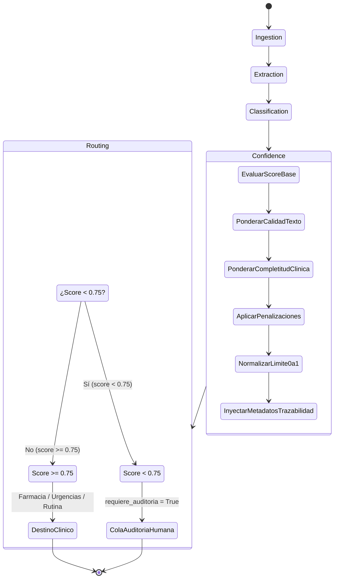

# Data Model: Calibrador de Score de Confianza Multimodal y Retención HITL

**Feature**: `006-confidence-score`  (`[IA-04]`, Issue `#31`)
**Date**: 2026-10-12  
**Status**: Completed  

---

## 1. Entidades Afectadas y Estructuras de Estado

### `AgentState` (LangGraph)
El grafo autónomo de MediFlow intercambia el estado global entre nodos.

| Atributo | Tipo | Descripción | Modificado por |
|---|---|---|---|
| `clasificacion` | `ClasificacionState` | Contiene los metadatos de clasificación clínica | `node_confidence` actualiza `score_confianza_clasificacion` |
| `metadata` | `dict[str, Any]` | Metadatos globales de auditoría y trazabilidad | `node_confidence` inyecta `factores_confianza` |
| `decision_enrutamiento` | `DecisionEnrutamientoState` | Decisión de cola de destino y necesidad de HITL | `node_routing` asigna `Cola_Auditoria_Humana` y `requiere_auditoria_humana = True` si score < 0.75 |
| `status_final` | `str` | Estado global de cierre del procesamiento | `node_routing` fija `"pendiente_auditoria"` si requiere auditoría |

---

### `ClasificacionState` (Pydantic Model en `state.py`)
```python
class ClasificacionState(BaseModel):
    tipo_documento: str = Field(description="Tipo de documento")
    especialidad: str = Field(description="Especialidad médica")
    nivel_prioridad: str = Field(description="Urgente | Rutina | Ambiguo")
    score_confianza_clasificacion: float = Field(
        ge=0.0,
        le=1.0,
        description="Score de confianza calibrado estrictamente entre 0.0 y 1.0 (3 decimales)",
    )
```

---

### `FactoresConfianza` (Metadata Dictionary)
Estructura inyectada en `state.metadata["factores_confianza"]`:
```json
{
  "score_base": 0.70,
  "ajuste_texto": 0.05,
  "ajuste_completitud": 0.15,
  "penalizaciones": 0.0,
  "score_final": 0.90,
  "umbral_minimo_requerido": 0.75,
  "retenido_por_confianza": false
}
```

---

## 2. Transición de Estados en el Grafo


