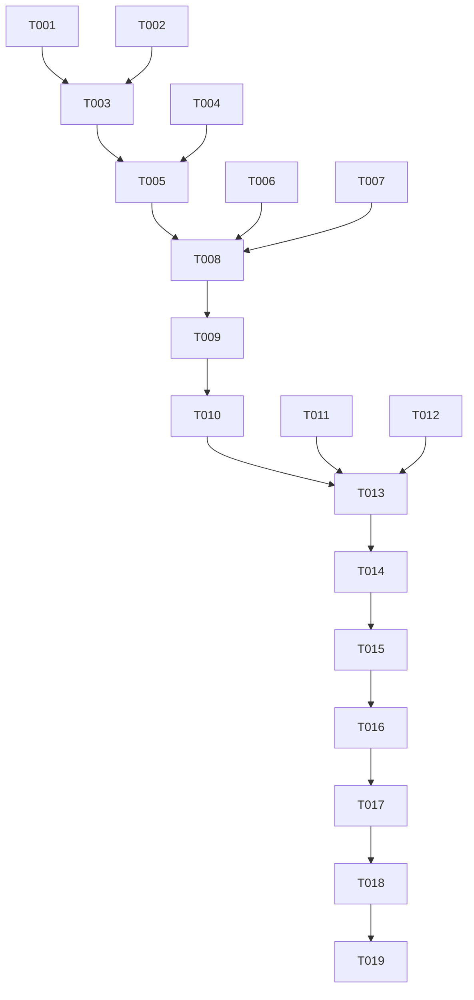

# Tasks: Calibrador de Score de Confianza Multimodal y Retención HITL

**Input**: Design documents from `/specs/006-confidence-score/`  
**Prerequisites**: plan.md, spec.md, research.md, data-model.md, contracts/confidence-contract.md  
**Branch**: `006-confidence-score` (desarrollado en `dev-henry-suarez`)  
**TDD Approach**: Pruebas unitarias e integración se escriben primero (RED) y se validan en verde (GREEN) conforme a la Regla de Oro.

---

## Phase 1: Setup & Environment Verification

**Purpose**: Asegurar dependencias y entorno de ejecución limpio

- [X] T001 Sincronizar y verificar el entorno virtual del backend mediante `uv sync --all-extras` en `backend/`
- [X] T002 [P] Verificar que la suite base de tests de triaje esté operativa en `backend/tests/test_destinos_triaje_unit.py`

---

## Phase 2: Foundational (Blocking Prerequisites)

**Purpose**: Constantes de calibración y modelos de estado para el cálculo de confianza

- [X] T003 Definir la constante `UMBRAL_CONFIANZA_HITL = 0.75` y el modelo de metadatos en `backend/app/agent/nodes/confidence.py`
- [X] T004 [P] Validar que `ClasificacionState` en `backend/app/agent/state.py` mantenga la restricción de rango `0.0 <= score <= 1.0`

**Checkpoint**: Estructuras base listas para proceder con TDD en las historias de usuario.

---

## Phase 3: User Story 1 - Calibración Granular y Ponderación Multimodal (Priority: P1) 🎯 MVP

**Goal**: Ponderar matemáticamente calidad de texto/OCR, imágenes y completitud de datos clínicos produciendo un score delimitado estrictamente entre 0.0 y 1.0.

**Independent Test**: Ejecutar `pytest backend/tests/test_confidence_calibration.py` con escenarios sintéticos (texto largo nítido, texto < 20 caracteres, datos clínicos completos vs incompletos).

### Tests for User Story 1 ⚠️
> **Escribir estas pruebas PRIMERO y verificar que fallen antes de implementar**

- [X] T005 [P] [US1] Crear suite de pruebas unitarias `backend/tests/test_confidence_calibration.py` para evaluar límites numéricos [0.0, 1.0] y redondeo a 3 decimales
- [X] T006 [P] [US1] Agregar pruebas en `backend/tests/test_confidence_calibration.py` para verificar bonificaciones por paciente, diagnóstico CIE-10 y signos vitales
- [X] T007 [P] [US1] Agregar pruebas en `backend/tests/test_confidence_calibration.py` para verificar penalizaciones por texto corto (< 20 caracteres) y errores previos

### Implementation for User Story 1
- [X] T008 [US1] Implementar en `backend/app/agent/nodes/confidence.py` la función granular `calcular_score_confianza(...)` con ponderaciones multimodales
- [X] T009 [US1] Integrar `calcular_score_confianza` en `node_confidence` dentro de `backend/app/agent/nodes/confidence.py` acotando con `max(0.0, min(1.0, score))`

**Checkpoint**: User Story 1 operativa al 100% con tests unitarios pasando en verde.

---

## Phase 4: User Story 2 - Retención Obligatoria por Umbral HITL (< 0.75) (Priority: P1)

**Goal**: Retener en `Cola_Auditoria_Humana` con `requiere_auditoria_humana = True` y `status = "pendiente_auditoria"` todo caso cuyo score calibrado sea < 0.75.

**Independent Test**: Ejecutar `pytest backend/tests/test_destinos_triaje_unit.py` verificando que un score de 0.74 es retenido y 0.75 continúa su flujo ordinario (si no hay urgencias).

### Tests for User Story 2 ⚠️
> **Escribir estas pruebas PRIMERO y verificar que fallen con el umbral anterior**

- [X] T010 [P] [US2] Agregar casos de prueba en `backend/tests/test_destinos_triaje_unit.py` para verificar que `score = 0.74` asigna `Cola_Auditoria_Humana` con `requiere_auditoria_humana = True`
- [X] T011 [P] [US2] Agregar pruebas en `backend/tests/test_destinos_triaje_unit.py` confirmando que `score = 0.75` permite flujo a `Cola_Rutina` o `Farmacia_Hospitalaria`
- [X] T012 [P] [US2] Verificar en `backend/tests/test_destinos_triaje_unit.py` que la prioridad `"Urgente"` y las discrepancias de identidad (Issue #29) preservan su precedencia sobre la auditoría de confianza

### Implementation for User Story 2
- [X] T013 [US2] Actualizar en `backend/app/agent/nodes/routing.py` la lógica de `_calcular_destino` para elevar el umbral a `if score < 0.75`
- [X] T014 [US2] Garantizar en `backend/app/agent/nodes/routing.py` que el estado del grafo se suspenda en `status_final = "pendiente_auditoria"` cuando el score sea < 0.75

**Checkpoint**: User Stories 1 y 2 integradas, verificadas y sin colisiones de precedencia.

---

## Phase 5: User Story 3 - Trazabilidad y Desglose Explicable de Factores (Priority: P2)

**Goal**: Inyectar en `state.metadata["factores_confianza"]` el detalle explicable de bonificaciones y penalizaciones para auditoría médica.

**Independent Test**: Verificar en `test_confidence_calibration.py` que el diccionario `factores_confianza` contenga desglose completo y bandera `retenido_por_confianza`.

### Tests for User Story 3 ⚠️
- [X] T015 [P] [US3] Agregar prueba en `backend/tests/test_confidence_calibration.py` que valide la estructura y valores del diccionario `factores_confianza` en `state.metadata`

### Implementation for User Story 3
- [X] T016 [US3] Actualizar el retorno de `node_confidence` en `backend/app/agent/nodes/confidence.py` para poblar `metadata["factores_confianza"]`

**Checkpoint**: Trazabilidad médica inmutable registrada y verificada.

---

## Phase 6: Polish & Cross-Cutting Concerns

**Purpose**: Verificación global de calidad y aseguramiento de la Regla de Oro (0 regresiones)

- [X] T017 Ejecutar la suite completa `pytest backend/tests/` para verificar 0 regresiones globales en el backend
- [X] T018 [P] Ejecutar validación de formato y linting con `ruff check backend/`
- [X] T019 Actualizar `specs/006-confidence-score/spec.md` cambiando Status a `Completed (100% Tests Passed)` tras finalizar

---

## Dependencies & Execution Order

---

## Implementation Strategy

1. **MVP Inmediato (User Story 1)**: Creación de tests unitarios de calibración en `test_confidence_calibration.py` e implementación de la fórmula granular en `confidence.py`.
2. **Seguridad Clínica (User Story 2)**: Actualización del umbral de corte a `0.75` en `routing.py` respetando precedencias clínicas.
3. **Explicabilidad (User Story 3)**: Exposición del desglose en `metadata`.
4. **Validación Global**: Ejecución de la suite completa de pruebas para garantizar 0 regresiones.
