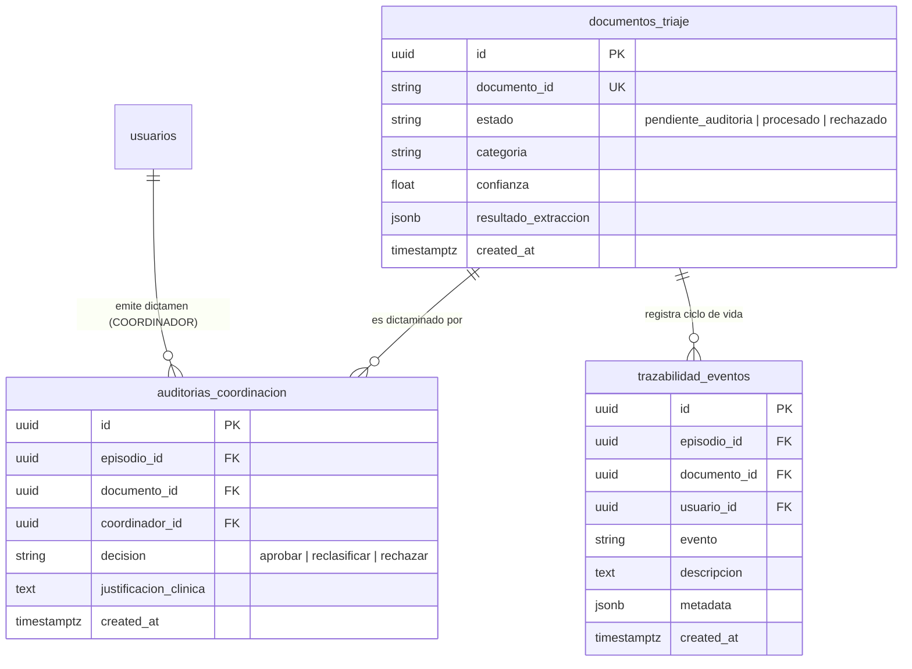

# Data Model: Endpoints REST de Coordinación y Auditoría Médica (HITL)

**Feature**: `specs/006-coordination-audit-api`
**Date**: 2026-10-09

## Entidades y Esquemas

### 1. Modelos de Entrada (Request Schemas)

#### `ResolveTriageRequest`
Modelo Pydantic v2 para la resolución de un triaje retenido por HITL.

```python
class DecisionAuditoriaEnum(str, Enum):
    APROBAR = "aprobar"
    RECLASIFICAR = "reclasificar"
    RECHAZAR = "rechazar"

class ResolveTriageRequest(BaseModel):
    model_config = ConfigDict(extra="forbid")

    decision: DecisionAuditoriaEnum = Field(
        ...,
        description="Decisión médica formal del coordinador (aprobar, reclasificar, rechazar)",
    )
    justificacion_clinica: str = Field(
        ...,
        min_length=5,
        max_length=2000,
        description="Justificación médica y criterio clínico para la resolución del caso",
        examples=["Se valida concordancia diagnóstica y se aprueba derivación a Cardiología"],
    )
    categoria_destino: str | None = Field(
        None,
        description="Nueva categoría o servicio clínico asignado si la decisión es reclasificar",
        examples=["Farmacia_Hospitalaria", "Observacion_Urgencias", "Cardiologia"],
    )
    prioridad_sugerida: str | None = Field(
        None,
        description="Ajuste de prioridad o nivel de urgencia clínico",
        examples=["ALTA", "MEDIA", "BAJA", "URGENTE", "RUTINA"],
    )
```

### 2. Modelos de Salida (Response Schemas)

#### `PendingTriageItemResponse`
Elemento que representa un caso de triaje pendiente de auditoría HITL.

```python
class PendingTriageItemResponse(BaseModel):
    model_config = ConfigDict(from_attributes=True)

    documento_id: str
    episodio_id: str | None = None
    fecha_ingesta: datetime
    tiempo_espera_minutos: int
    estado: str
    canal_origen: str = "Admision"
    especialidad_sugerida: str | None = None
    nivel_prioridad: str | None = None
    confianza_ia: float | None = None
    motivo_hitl: str | None = None
    diagnostico_preliminar: str | None = None
    codigo_cie10: str | None = None
    paciente: dict[str, Any] | None = None
```

#### `ResolveTriageResponse`
Respuesta tras registrar exitosamente el dictamen médico.

```python
class ResolveTriageResponse(BaseModel):
    model_config = ConfigDict(from_attributes=True)

    id: str
    documento_id: str
    episodio_id: str | None = None
    coordinador_id: str
    decision: str
    justificacion_clinica: str
    nuevo_estado: str
    created_at: datetime
    mensaje: str = "Resolución médica registrada exitosamente."
```

#### `AuditEventItemResponse`
Elemento para el historial de eventos de auditoría y trazabilidad.

```python
class AuditEventItemResponse(BaseModel):
    model_config = ConfigDict(from_attributes=True)

    id: str
    documento_id: str
    episodio_id: str | None = None
    usuario_id: str | None = None
    evento: str
    descripcion: str
    metadata: dict[str, Any] = Field(default_factory=dict)
    created_at: datetime
```

## Relación con Tablas PostgreSQL


