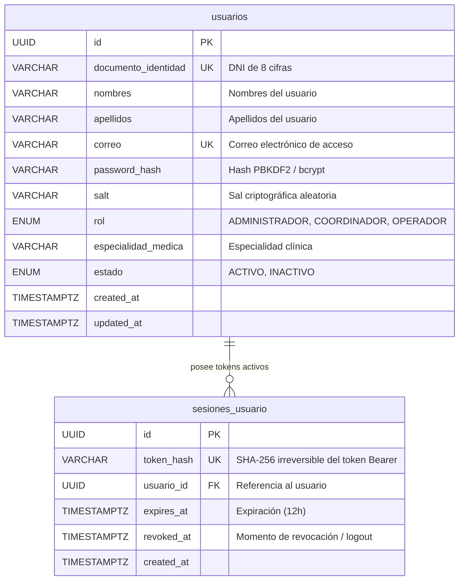

# Data Model: Autenticación por Correo y Gestión Global de Sesión

**Fecha**: 2026-10-12  
**Feature**: `006-login-email-auth`

---

## 1. Diagrama de Relaciones y Flujo de Datos

---

## 2. Entidades y Esquemas de Datos

### 2.1. Payload de Entrada: `LoginRequest` (Backend)
Payload recibido en `POST /api/v1/auth/login`.

| Campo | Tipo | Requerido | Validación | Propósito |
| :--- | :--- | :--- | :--- | :--- |
| `correo` | `string` | Opcional* | Formato de email válido | Correo electrónico del usuario |
| `documento_identidad` | `string` | Opcional* | 8 cifras numéricas | Retrocompatibilidad |
| `password` | `string` | Sí | No vacío | Contraseña en texto plano |

*\*Se requiere al menos `correo` o `documento_identidad`. En el frontend de login se envía exclusivamente `correo`.*

---

### 2.2. Entidad de Usuario y Perfil Global: `UserResponse` / `User`
Objeto devuelto en `POST /api/v1/auth/login` y `GET /api/v1/auth/me`.

| Atributo | Tipo SQL / TS | Nullable | Propósito Clínico / Operativo |
| :--- | :--- | :--- | :--- |
| `id` | `UUID` / `string` | No | Identificador único de usuario para trazabilidad hospitalaria |
| `documento_identidad` | `VARCHAR(20)` / `string` | No | Número de identidad nacional (DNI) |
| `nombres` | `VARCHAR(100)` / `string` | No | Nombres de pila del profesional |
| `apellidos` | `VARCHAR(100)` / `string` | No | Apellidos del profesional |
| `correo` | `VARCHAR(255)` / `string` | No | Dirección de correo institucional |
| `telefono` | `VARCHAR(50)` / `string` | Sí | Teléfono de contacto |
| `rol` | `VARCHAR(50)` / `string` | No | Nivel de autorización: `ADMINISTRADOR`, `COORDINADOR`, `OPERADOR` |
| `especialidad_medica` | `VARCHAR(100)` / `string` | Sí | Especialidad médica (ej: *Medicina General*, *Cardiología*, etc.) |
| `estado` | `VARCHAR(20)` / `string` | No | Estado de cuenta: `ACTIVO` o `INACTIVO` |
| `created_at` | `TIMESTAMPTZ` / `string` | Sí | Fecha de registro |

---

### 2.3. Sesión y Token de Acceso (`LoginResponse` & `SessionUser`)

| Atributo | Ubicación | Descripción y Seguridad |
| :--- | :--- | :--- |
| `access_token` | HTTP Response (`LoginResponse`) | Token Bearer opaco: `mf_session_<64 hex>` (generado con `secrets.token_hex(32)`) |
| `token_type` | HTTP Response (`LoginResponse`) | `"Bearer"` |
| `token_hash` | Base de datos (`sesiones_usuario`) | Hash SHA-256 irreversible (`token_digest(token)`). **El token en texto plano nunca se guarda en la base de datos**. |
| `localStorage` | Navegador Cliente | Almacena `{ access_token: "mf_session_..." }` bajo la clave `"mediflow_auth_session"`. **No guarda contraseñas, hashes ni sales**. |
| `AuthContext` (`SessionUser`) | Memoria RAM React | Almacena el usuario completo rehidratado: `User & { token: string }` para acceso rápido y seguro vía `useAuth()`. |
| `revoked_at` | Base de datos (`sesiones_usuario`) | Marca de revocación al ejecutar `POST /api/v1/auth/logout`. Invalida inmediatamente el token en PostgreSQL. |

