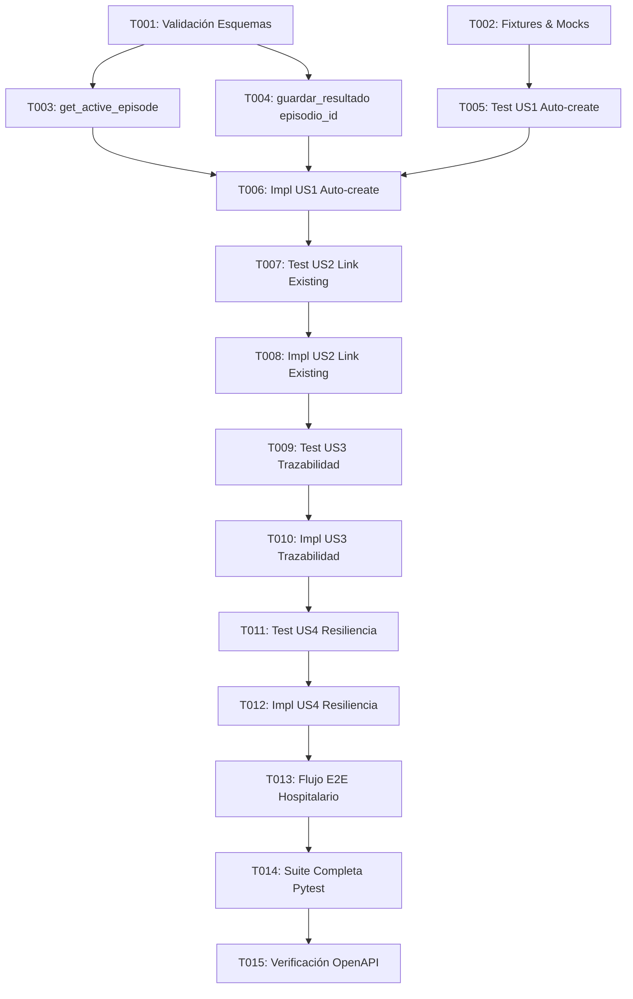

# Tasks: Orquestación de Triaje con Creación y Vinculación Automática de Episodios Clínicos

**Input**: Design documents from `/specs/007-triage-episode-orchestration/`
**Prerequisites**: [plan.md](./plan.md), [spec.md](./spec.md), [research.md](./research.md), [data-model.md](./data-model.md), [contracts/](./contracts/triage-episode-contract.yaml)

## Format: `[ID] [P?] [Story] Description`

- **[P]**: Ejecutable en paralelo (archivos independientes, sin dependencias bloqueantes)
- **[Story]**: Historia de usuario a la que pertenece la tarea ([US1], [US2], [US3], [US4])
- Cada tarea define una acción clara con la ruta exacta del archivo a intervenir.

---

## Phase 1: Setup & Infraestructura Compartida

**Propósito**: Preparación de fixtures, validación de esquemas y configuración de pruebas.

- [X] T001 Validar compatibilidad de esquemas relacionales (`episodios_clinicos`, `documentos_triaje.episodio_id`, `trazabilidad_eventos`) con las migraciones activas en `backend/alembic/versions/`.
- [X] T002 [P] Preparar fixtures y mocks auxiliares para pruebas de episodios y triaje en `backend/tests/test_triage_api.py`.

---

## Phase 2: Foundational (Prerrequisitos Bloqueantes)

**Propósito**: Métodos base en los repositorios de persistencia antes de orquestar el servicio.

- [X] T003 [P] Implementar función de consulta de episodio activo `get_active_episode_by_patient(paciente_id)` en `backend/app/repositories/episode_repository.py`.
- [X] T004 [P] Actualizar persistencia de `episodio_id` en `guardar_resultado` en `backend/app/repositories/postgres_storage.py` (soporte SQL asyncpg y almacén en memoria para tests).

**Punto de Control**: La base de datos y los repositorios disponen de las operaciones fundamentales de lectura y escritura de episodios.

---

## Phase 3: User Story 1 - Apertura Automática de Episodio Clínico (Priority: P1) 🎯 MVP

**Objetivo**: Si un paciente resuelto no tiene episodio activo, crear automáticamente un registro en `episodios_clinicos` y asignarlo a `documentos_triaje`.
**Criterio de Prueba Independiente**: Procesar un documento de un paciente identificado sin atenciones previas; el sistema debe responder con éxito y registrar el nuevo episodio clínico asociado.

### Tests para User Story 1 (TDD - Test First)
- [X] T005 [P] [US1] Crear prueba unitaria en `backend/tests/test_triage_api.py` que verifique la creación automática de un nuevo episodio clínico al triar un paciente sin episodio previo.

### Implementación para User Story 1
- [X] T006 [US1] Implementar en `backend/app/services/triage_service.py` la creación automática de episodio con `create_episode(...)` vinculando prioridad, motivo y especialidad en `metadata["episodio_id"]`.

**Punto de Control**: User Story 1 operativa como MVP independiente.

---

## Phase 4: User Story 2 - Vinculación a Episodio Clínico Activo Existente (Priority: P2)

**Objetivo**: Si el paciente ya cuenta con una atención activa en curso (`ingresado`, `en_triaje`, `evaluacion_general`), asociar el nuevo documento al episodio existente sin duplicar registros.
**Criterio de Prueba Independiente**: Procesar un documento complementario para un paciente con un episodio en curso; el sistema debe asociar el documento al episodio activo existente.

### Tests para User Story 2 (TDD - Test First)
- [X] T007 [P] [US2] Crear prueba unitaria en `backend/tests/test_triage_api.py` que compruebe que no se duplican episodios cuando el paciente ya tiene uno activo.

### Implementación para User Story 2
- [X] T008 [US2] Implementar en `backend/app/services/triage_service.py` la consulta previa a `get_active_episode_by_patient(...)` para reutilizar el episodio existente si está activo.

**Punto de Control**: La vinculación a episodios existentes funciona sin duplicidad asistencial.

---

## Phase 5: User Story 3 - Registro Inmutable de Trazabilidad Hospitalaria (Priority: P3)

**Objetivo**: Emitir el evento inmutable `DOCUMENTO_ASOCIADO_A_EPISODIO` en `trazabilidad_eventos` con `AuditRepository`.
**Criterio de Prueba Independiente**: Validar que tras la asociación de un documento a un episodio (nuevo o existente), se genera el registro en la bitácora con sus metadatos clínicos.

### Tests para User Story 3 (TDD - Test First)
- [X] T009 [P] [US3] Crear prueba unitaria en `backend/tests/test_triage_api.py` que verifique la invocación de `AuditRepository.registrar_evento_trazabilidad` con el evento `DOCUMENTO_ASOCIADO_A_EPISODIO`.

### Implementación para User Story 3
- [X] T010 [US3] Conectar en `backend/app/services/triage_service.py` el registro de auditoría y trazabilidad tras asociar el episodio.

**Punto de Control**: Trazabilidad inmutable de grado hospitalario garantizada en PostgreSQL.

---

## Phase 6: User Story 4 - Resiliencia y Continuidad Operativa ante Fallos (Priority: P4)

**Objetivo**: Asegurar que fallos en la persistencia secundaria de episodios no aborten la entrega del resultado de triaje al personal asistencial.
**Criterio de Prueba Independiente**: Simular una falla en el subsistema de episodios; el servicio debe entregar el análisis de triaje con HTTP 200 y registrar la contingencia en los logs.

### Tests para User Story 4 (TDD - Test First)
- [X] T011 [P] [US4] Crear prueba unitaria en `backend/tests/test_triage_api.py` que simule una excepción en `episode_repository` y verifique que el servicio responde exitosamente sin interrumpir el triaje.

### Implementación para User Story 4
- [X] T012 [US4] Envolver la orquestación de episodios en `backend/app/services/triage_service.py` dentro de un bloque resiliente `try...except` con logging estructurado.

**Punto de Control**: Alta disponibilidad clínica verificada ante contingencias.

---

## Phase 7: Polish, Flujo E2E & Puerta de Calidad

**Propósito**: Integración con el flujo E2E hospitalario completo y verificación de calidad con 0 regresiones.

- [X] T013 Integrar la verificación de creación de episodio clínico y trazabilidad inmutable en la prueba E2E hospitalaria en `backend/tests/test_e2e_hospital_flow.py`.
- [X] T014 Ejecutar la suite completa de pruebas con `pytest` asegurando 100% tests en verde sin mutar `mediflow_dev`.
- [X] T015 Verificar consistencia con especificaciones OpenAPI en `specs/openapi.yaml`.

---

## Dependencias y Orden de Ejecución

## Oportunidades de Ejecución en Paralelo

- **Fase 2**: `T003` (`episode_repository.py`) y `T004` (`postgres_storage.py`) pueden desarrollarse en paralelo al afectar archivos distintos.
- **Fase 3 a 6 (Tests)**: `T005`, `T007`, `T009` y `T011` pueden formularse como funciones de prueba independientes dentro de `test_triage_api.py`.

## Estrategia de Entrega Incremental (MVP)

1. **Incremento 1 (MVP - US1)**: Tareas `T001` a `T006`. Permite que cualquier documento procesado para un paciente sin atención abierta cree un episodio clínico.
2. **Incremento 2 (US2)**: Tareas `T007` y `T008`. Previene la duplicación de atenciones para pacientes en curso.
3. **Incremento 3 (US3 & US4)**: Tareas `T009` a `T012`. Auditoría inmutable de eventos y blindaje de alta disponibilidad.
4. **Incremento 4 (Cierre)**: Tareas `T013` a `T015`. Validación E2E integral y 0 regresiones.
