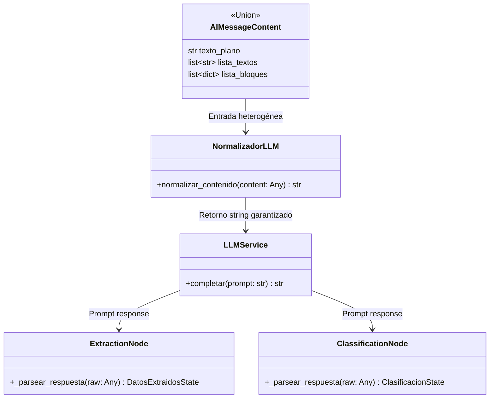

# Data Model: Flujo de Normalización de Respuestas LLM

## 1. Tipos de Contenido del Proveedor LLM



## 2. Definición de Estructuras

### Entrada Cruda (Ejemplos soportados):
1. **Cadena simple**:
   `'{"paciente": {"nombre": "Mateo Torres"}, ...}'`
2. **Lista de diccionarios (Gemini Multimodal)**:
   `[{'type': 'text', 'text': '```json\n{"paciente": {"nombre": "Mateo Torres"}, ...}\n```'}]`
3. **Lista de cadenas simples**:
   `['{"paciente":', '{"nombre": "Mateo Torres"}, ...}']`

### Salida Normalizada:
- Siempre `str` codificado en UTF-8, limpio y consolidado.

### Estados de Salida de Nodos:
- `DatosExtraidosState`: Modelo Pydantic inmutable con paciente, médico, estudio, diagnóstico, CIE-10 y hallazgos.
- `ClasificacionState`: Modelo Pydantic inmutable con tipo de documento, especialidad, nivel de prioridad y score base.
