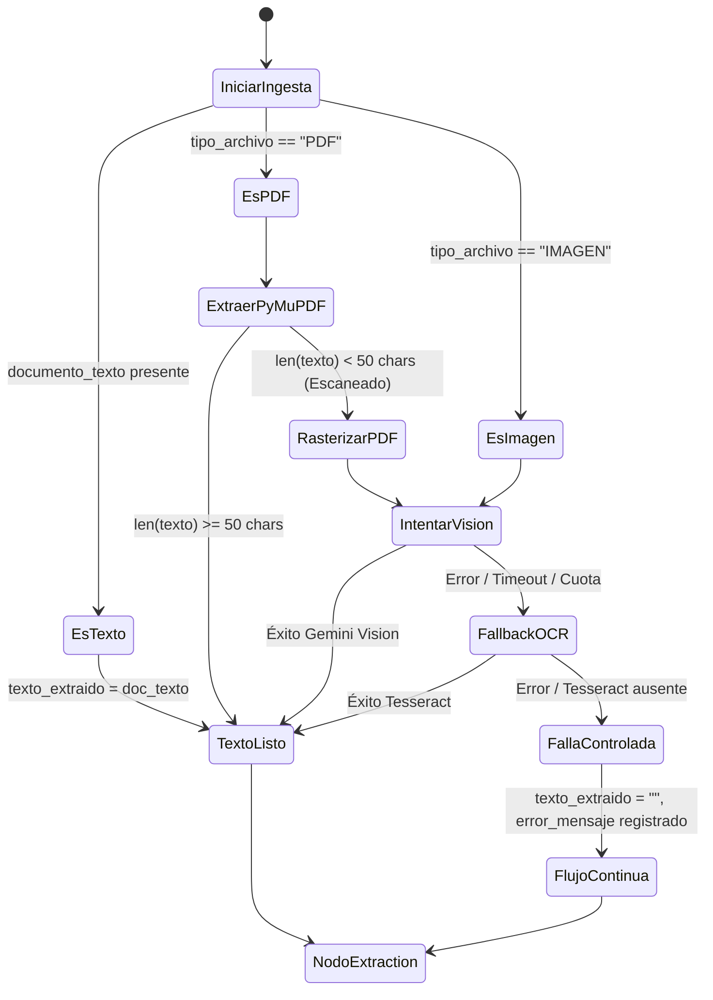

# Data Model: Ingesta Híbrida Multimodal y OCR

**Feature**: `009-multimodal-vision-ocr`  
**Date**: 2026-10-12  

---

## 1. Entidades del Estado del Agente (`AgentState`)

El estado compartido a lo largo del grafo de LangGraph mantiene la siguiente estructura para el soporte multimodal:

```python
class AgentState(BaseModel):
    # Identificadores y entrada
    documento_id: str
    canal_origen: str = "Email_Triaje"
    tipo_archivo: str  # "PDF" | "IMAGEN" | "TEXTO" | "JSON"
    documento_texto: str | None = None
    documento_base64: str | None = None

    # Nodo: ingestion
    texto_extraido: str | None = None
    metodo_extraccion: str | None = (
        None  # "TEXT_EXTRACTION" | "MULTIMODAL_VISION" | "LOCAL_OCR" | "NONE"
    )

    # Nodos posteriores
    datos_extraidos: DatosExtraidosState | None = None
    clasificacion: ClasificacionState | None = None
    confianza: ConfianzaState | None = None
    decision_enrutamiento: DecisionEnrutamientoState | None = None

    # Control de flujo y auditoría
    nodos_ejecutados: list[str] = Field(default_factory=list)
    status: str = "procesando"  # "procesado" | "pendiente_auditoria" | "error"
    error_mensaje: str | None = None
```

---

## 2. Estructura de Carga Multimodal (`ImagePayload`)

Estructura de entrada consumida por `LLMService.completar_multimodal()`:

```python
class ImageInput(BaseModel):
    mime_type: str  # "image/jpeg", "image/png", "image/webp"
    data_base64: str  # Contenido binario codificado en Base64 sin prefijo
```

---

## 3. Transiciones de Estado en el Nodo de Ingesta



---

## 4. Persistencia en Base de Datos PostgreSQL

No se requieren nuevas tablas en la base de datos relacional. Los resultados de la ingesta y trazabilidad se persisten en:
- `documentos_triaje.metadata`: Almacena `metodo_extraccion`, páginas procesadas y tipo MIME detectado.
- `auditoria_triaje`: Registra los eventos `NODO_INGESTION_EXITO` o `NODO_INGESTION_FALLBACK_OCR`.
- `episodios_clinicos`: Se asocia al paciente una vez clasificado el documento.
