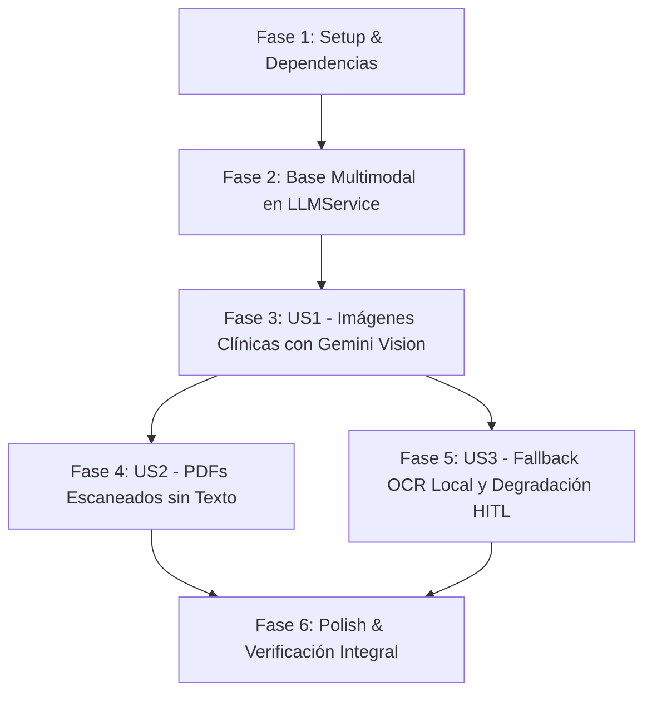

# Tasks: Ingesta Híbrida Multimodal con Gemini Vision y OCR Local

**Feature**: `009-multimodal-vision-ocr`  
**Input**: [spec.md](./spec.md), [plan.md](./plan.md), [data-model.md](./data-model.md), [contracts/vision-ocr-contract.yaml](./contracts/vision-ocr-contract.yaml)  
**Status**: Ready for Implementation  

---

## Dependencies & Execution Order

---

## Phase 1: Setup

- [x] T001 Verificar librerías de soporte de imagen y documentos (`Pillow`, `fitz` PyMuPDF) en `backend/pyproject.toml`
- [x] T002 Ampliar detección de tipos binarios (soporte WebP y firmas de imagen) en función `_detectar_tipo_archivo` en `backend/app/api/v1/triage.py`

---

## Phase 2: Foundational

- [x] T003 Crear suite de pruebas base para llamadas multimodales en `backend/tests/test_ingestion_multimodal.py`
- [x] T004 Implementar método `completar_multimodal(prompt, imagenes)` en `backend/app/services/llm_service.py` con bloques `image_url` en base64 para `ChatGoogleGenerativeAI` y fallback mock controlado

---

## Phase 3: User Story 1 - Procesamiento de Imágenes Médicas (Priority: P1)

**Goal**: Permitir la carga e interpretación visual de imágenes (JPEG, PNG, WebP) mediante Gemini Vision extrayendo texto y estructurando diagnósticos.  
**Independent Test**: Subir una imagen médica válida (JPG/PNG) y verificar que `node_ingestion` extrae texto legible mediante visión y clasifica el caso sin errores.

- [x] T005 [P] [US1] Escribir prueba unitaria de extracción de texto desde imagen en base64 en `backend/tests/test_ingestion_multimodal.py`
- [x] T006 [US1] Modificar `_extraer_texto_imagen` en `backend/app/agent/nodes/ingestion.py` para invocar primariamente `LLMService.completar_multimodal()` con prompt clínico de transcripción
- [x] T007 [US1] Actualizar `node_ingestion` en `backend/app/agent/nodes/ingestion.py` para inyectar `metodo_extraccion="MULTIMODAL_VISION"` en el estado del agente

---

## Phase 4: User Story 2 - Ingesta de PDFs Escaneados (Priority: P2)

**Goal**: Detectar automáticamente PDFs sin capa de texto embebido y rasterizar páginas con PyMuPDF para su procesamiento con Gemini Vision.  
**Independent Test**: Subir un PDF escaneado (sin texto vectorial) y verificar que el sistema renderiza las páginas a pixmap y extrae el contenido mediante visión multimodal.

- [x] T008 [P] [US2] Escribir prueba unitaria para PDF escaneado con texto vectorial < 50 caracteres en `backend/tests/test_ingestion_multimodal.py`
- [x] T009 [US2] Implementar rasterización en memoria con PyMuPDF (`page.get_pixmap()`) y envío a visión multimodal en `_extraer_texto_pdf` en `backend/app/agent/nodes/ingestion.py`

---

## Phase 5: User Story 3 - Resiliencia Hospitalaria y Fallback OCR (Priority: P3)

**Goal**: Si el motor de visión falla o está inaccesible, ejecutar fallback a OCR local (Tesseract); si Tesseract no está instalado, capturar el error de forma segura y derivar a `pendiente_auditoria` (HITL).  
**Independent Test**: Simular caída o excepción del motor de visión y verificar que se activa el OCR de respaldo o se enruta de forma controlada a auditoría clínica con mensaje descriptivo y status 200/pendiente.

- [x] T010 [P] [US3] Escribir pruebas de contingencia simulando fallo de Gemini Vision y ausencia de Tesseract en `backend/tests/test_ingestion_multimodal.py`
- [x] T011 [US3] Implementar cadena de contingencia con bloque try/catch defensivo en `backend/app/agent/nodes/ingestion.py` registrando `metodo_extraccion="LOCAL_OCR"` o derivación a auditoría

---

## Phase 6: Polish & Cross-Cutting Concerns

- [x] T012 [P] Validar trazabilidad y persistencia de metadatos de ingesta en `backend/app/services/triage_service.py`
- [x] T013 Ejecutar suite completa de backend (`.venv/bin/pytest`) garantizando 0 fallos y 0 regresiones
- [x] T014 Ejecutar compilación de frontend (`npm test -- --run` y `npm run build`) para verificar contratos
