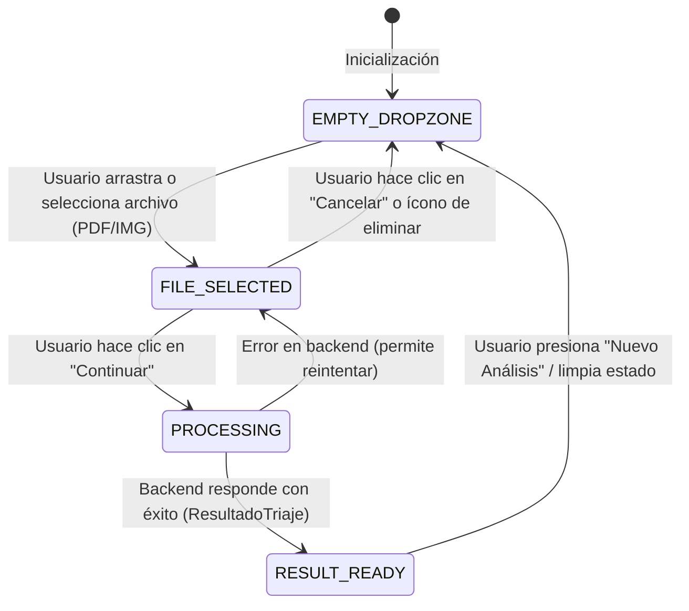

# Data Model & State Architecture: Rediseño Visual del Modal y Carga de Archivos

**Feature**: `009-triage-modal-redesign`
**Date**: 2026-10-13
**Status**: Completed

---

## 1. Máquina de Estados del Modal de Ingesta

El modal `Ejecutar nuevo análisis` maneja los siguientes estados principales:



---

## 2. Tipos de Datos y Estructuras

### 2.1. Píldoras de Navegación RBAC

```typescript
export interface NavPillOption {
  id: 'enrutamiento' | 'historial' | 'solicitudes'
  label: string
  route: string
  rolesPermitidos: ('ADMINISTRADOR' | 'OPERADOR' | 'AUDITOR' | 'SUPERVISOR')[]
}

export const NAV_PILLS: NavPillOption[] = [
  {
    id: 'enrutamiento',
    label: 'Enrutamiento',
    route: '/triaje',
    rolesPermitidos: ['ADMINISTRADOR', 'OPERADOR', 'AUDITOR', 'SUPERVISOR'],
  },
  {
    id: 'historial',
    label: 'Historial',
    route: '/documentos',
    rolesPermitidos: ['ADMINISTRADOR', 'OPERADOR', 'AUDITOR', 'SUPERVISOR'],
  },
  {
    id: 'solicitudes',
    label: 'Solicitudes',
    route: '/auditoria',
    rolesPermitidos: ['ADMINISTRADOR'], // Exclusivo para ADMINISTRADOR según requerimiento
  },
]
```

### 2.2. Estado del Archivo Seleccionado (`StagedFileState`)

```typescript
export interface StagedFileState {
  file: File | null
  fileName: string
  fileSizeFormatted: string // ej. "4.6 MB" o "520 KB"
  fileExtension: string     // ej. "pdf", "png", "jpg"
  uploadProgress: number    // ej. 0 a 100% durante simulación/subida
  status: 'idle' | 'uploading' | 'completed' | 'error'
  errorMessage?: string
}
```

### 2.3. Parámetros de Enrutamiento Preservados

```typescript
export interface TriageFormState {
  docId: string
  canalOrigen: 'Guardia_Emergencias' | 'Consulta_Externa' | 'Admision' | 'Laboratorio'
  fileToUpload: File | null
  loading: boolean
  error: string | null
  resultado: ResultadoTriaje | null
}
```

---

## 3. Formateo y Utilidades

- **Cálculo de Tamaño**:
  ```typescript
  const formatFileSize = (bytes: number): string => {
    if (bytes >= 1024 * 1024) {
      return `${(bytes / (1024 * 1024)).toFixed(1)} MB`
    }
    return `${Math.round(bytes / 1024)} KB`
  }
  ```
- **Validación de Archivo**:
  - Extensiones admitidas: `.pdf`, `.png`, `.jpg`, `.jpeg`, `.json`.
  - Tamaño máximo: `10 * 1024 * 1024` bytes (10 MB).

