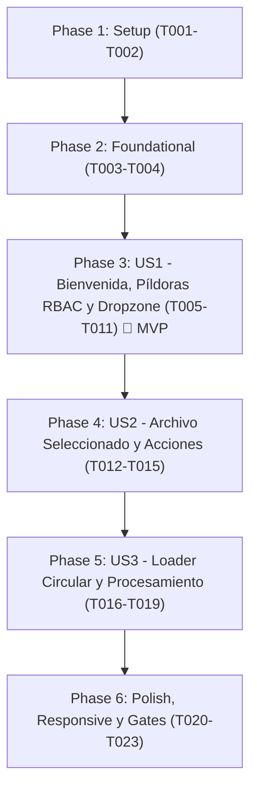

# Tasks: Rediseño Visual del Modal y Carga de Archivos en NewDocument

**Input**: Design documents from `specs/009-triage-modal-redesign/`
**Prerequisites**: [plan.md](file:///c:/Users/owl_d/Documents/CURSOS/ORACLE_ONE_AI_FOR_TECH/Hackaton/G10-LATAM-TEAM-02-MediFlowI-Agente-IA/specs/009-triage-modal-redesign/plan.md), [spec.md](file:///c:/Users/owl_d/Documents/CURSOS/ORACLE_ONE_AI_FOR_TECH/Hackaton/G10-LATAM-TEAM-02-MediFlowI-Agente-IA/specs/009-triage-modal-redesign/spec.md), [research.md](file:///c:/Users/owl_d/Documents/CURSOS/ORACLE_ONE_AI_FOR_TECH/Hackaton/G10-LATAM-TEAM-02-MediFlowI-Agente-IA/specs/009-triage-modal-redesign/research.md), [data-model.md](file:///c:/Users/owl_d/Documents/CURSOS/ORACLE_ONE_AI_FOR_TECH/Hackaton/G10-LATAM-TEAM-02-MediFlowI-Agente-IA/specs/009-triage-modal-redesign/data-model.md), [contracts/ui-contracts.md](file:///c:/Users/owl_d/Documents/CURSOS/ORACLE_ONE_AI_FOR_TECH/Hackaton/G10-LATAM-TEAM-02-MediFlowI-Agente-IA/specs/009-triage-modal-redesign/contracts/ui-contracts.md), [quickstart.md](file:///c:/Users/owl_d/Documents/CURSOS/ORACLE_ONE_AI_FOR_TECH/Hackaton/G10-LATAM-TEAM-02-MediFlowI-Agente-IA/specs/009-triage-modal-redesign/quickstart.md)

---

## Phase 1: Setup (Shared Infrastructure)

**Purpose**: Preparación de importaciones de FontAwesome, variables de estilo y tipos compartidos

- [X] T001 Verificar importaciones de iconos FontAwesome (`@fortawesome/react-fontawesome`, `@fortawesome/free-solid-svg-icons`) en `frontend/src/pages/NewDocument.tsx`
- [X] T002 [P] Definir tipos de estado para el modal de ingesta y píldoras RBAC en `frontend/src/types/triageModal.types.ts`

---

## Phase 2: Foundational (Blocking Prerequisites)

**Purpose**: Suite inicial de pruebas unitarias y componentes auxiliares que bloquean la implementación

- [X] T003 [P] Crear suite de pruebas para renderizado visual del modal y RBAC de píldoras en `frontend/src/pages/NewDocument.test.tsx`
- [X] T004 [P] Implementar función utilitaria de formateo de tamaño de archivos en `frontend/src/utils/fileFormatting.ts`

**Checkpoint**: Infraestructura y pruebas listas - Inicio de implementación por historias de usuario.

---

## Phase 3: User Story 1 - Presentación Visual de Bienvenida, Píldoras RBAC y Zona de Ingesta (Priority: P1) 🎯 MVP

**Goal**: Mostrar la cabecera centrada, las píldoras de navegación con control RBAC, la barra del motor IA y el modal blanco con dropzone estilizada respetando la paleta de colores y el dropdown de canal de origen.

**Independent Test**: Acceder a `/triaje` con rol `ADMINISTRADOR` y verificar que aparecen 3 píldoras (`Enrutamiento`, `Historial`, `Solicitudes`) con navegación operativa a sus respectivas rutas; acceder con otro rol y verificar que solo aparecen 2 píldoras (`Enrutamiento`, `Historial`). Verificar la presentación del título, barra del motor IA (`GPT-5.2`), dropzone con icono FontAwesome `faFolder`, botón azul `Seleccionar archivos` y el dropdown de canal de origen preservado.

### Tests for User Story 1

- [X] T005 [P] [US1] Añadir pruebas unitarias para validar las 3 opciones de píldora para `ADMINISTRADOR` y 2 opciones para otros roles en `frontend/src/pages/NewDocument.test.tsx`
- [X] T006 [P] [US1] Añadir pruebas unitarias para validar la presencia del selector de canal de origen y dropzone inicial en `frontend/src/pages/NewDocument.test.tsx`

### Implementation for User Story 1

- [X] T007 [US1] Implementar navegación superior tipo píldora (`[ Enrutamiento | Historial | Solicitudes ]`) con filtrado por rol y redirección vía `useNavigate` en `frontend/src/pages/NewDocument.tsx`
- [X] T008 [US1] Implementar encabezado centrado con saludo dinámico `Buen día Dr. [Nombre]` y subtítulo descriptivo con Tailwind CSS en `frontend/src/pages/NewDocument.tsx`
- [X] T009 [US1] Implementar barra superior de motor IA con badge verde secundario (`GPT-5.2` con fondo `--secondary: #6FCF97`) e icono FontAwesome `faSliders` en `frontend/src/pages/NewDocument.tsx`
- [X] T010 [US1] Diseñar la tarjeta modal "Ejecutar nuevo análisis" (`rounded-3xl`, fondo blanco, sombra suave) con dropzone de borde punteado, icono FontAwesome `faFolder` con halo suave, enlace de búsqueda y botón institucional `--primary: #2C5282` "Seleccionar archivos" en `frontend/src/pages/NewDocument.tsx`
- [X] T011 [US1] Integrar y preservar el selector dropdown de `Canal de Origen` de manera armónica dentro de la tarjeta modal en `frontend/src/pages/NewDocument.tsx`

**Checkpoint**: User Story 1 completamente operativa (MVP listo e independientemente verificable).

---

## Phase 4: User Story 2 - Visualización Estilizada del Archivo Cargado y Acciones de Control (Priority: P2)

**Goal**: Reemplazar la dropzone por una fila horizontal redondeada con icono de clip de FontAwesome `faPaperclip`, nombre, tamaño y botones inferiores "Cancelar" y "Continuar" al adjuntar un archivo.

**Independent Test**: Seleccionar un archivo (PDF o imagen): comprobar que la dropzone da paso a la barra gris clara (`bg-slate-100`), mostrando el clip, nombre, tamaño en MB, botón "Cancelar" (que limpia el archivo y vuelve al dropzone) y botón "Continuar" (fondo `--primary: #2C5282`).

### Tests for User Story 2

- [X] T012 [P] [US2] Añadir pruebas unitarias para la transición a estado de archivo cargado y el descarte con "Cancelar" en `frontend/src/pages/NewDocument.test.tsx`

### Implementation for User Story 2

- [X] T013 [US2] Implementar la vista del archivo seleccionado: fila horizontal redondeada con fondo `bg-slate-100`, icono FontAwesome `faPaperclip`, nombre truncable, tamaño formateado e icono de remoción en `frontend/src/pages/NewDocument.tsx`
- [X] T014 [US2] Implementar botón secundario "Cancelar" que descarta el archivo y restablece el modal a dropzone vacía en `frontend/src/pages/NewDocument.tsx`
- [X] T015 [US2] Implementar botón primario "Continuar" estilizado con `--primary: #2C5282` para desencadenar el envío del triaje en `frontend/src/pages/NewDocument.tsx`

**Checkpoint**: User Story 2 completamente funcional y testable de forma autónoma.

---

## Phase 5: User Story 3 - Retroalimentación de Procesamiento y Loader Circular con FontAwesome (Priority: P3)

**Goal**: Mostrar el loader circular giratorio de FontAwesome (`faSpinner` / `faCircleNotch`) y el porcentaje de progreso en la fila del archivo mientras se procesa la solicitud al backend, manteniendo los botones deshabilitados.

**Independent Test**: Enviar un documento y verificar que durante `loading === true` la barra del archivo exhibe el spinner giratorio y/o porcentaje, con el botón "Continuar" deshabilitado hasta recibir la respuesta diagnóstica.

### Tests for User Story 3

- [X] T016 [P] [US3] Añadir prueba unitaria para validar la activación del spinner de FontAwesome durante el estado `loading === true` en `frontend/src/pages/NewDocument.test.tsx`

### Implementation for User Story 3

- [X] T017 [US3] Integrar el loader circular animado de FontAwesome (`faSpinner` / `faCircleNotch` con clase `fa-spin` / `animate-spin`) y porcentaje de progreso dentro de la fila del archivo en `frontend/src/pages/NewDocument.tsx`
- [X] T018 [US3] Inhabilitar temporalmente los botones de acción ("Cancelar" y "Continuar") durante el procesamiento para evitar peticiones concurrentes en `frontend/src/pages/NewDocument.tsx`
- [X] T019 [US3] Preservar la presentación de los resultados del diagnóstico y los badges HITL tras la respuesta del agente IA en `frontend/src/pages/NewDocument.tsx`

**Checkpoint**: Flujo completo de carga y procesamiento con retroalimentación visual finalizado.

---

## Phase 6: Polish & Cross-Cutting Concerns

**Purpose**: Verificación de responsividad, cero regresiones en el Sidebar y cumplimiento estricto de los Quality Gates.

- [X] T020 [P] Verificar responsividad en resoluciones móvil (`sm`), tablet (`md`) y escritorio (`lg`) con Tailwind CSS en `frontend/src/pages/NewDocument.tsx`
- [X] T021 Verificar que el Sidebar en `frontend/src/components/layout/Sidebar.tsx` permanezca 100% intacto y funcional
- [X] T022 Ejecutar suite completa de tests de frontend (`vitest run`) en `frontend/` asegurando 100% de pruebas en verde
- [X] T023 Ejecutar compilación de producción (`npm run build`) en `frontend/` asegurando 0 errores de TypeScript

---

## Dependencies & Story Flow

---

## Parallel Execution Opportunities

- **T003**, **T004**: Creación en paralelo de la suite de pruebas unitarias y la utilidad de formateo de archivos.
- **T005**, **T006**: Redacción en paralelo de las pruebas unitarias para píldoras RBAC y dropzone.
- **T012**, **T016**: Creación de pruebas de estado cargado y estado procesando.
- **T020**, **T021**: Verificación de responsividad en paralelo con la verificación del Sidebar.

---

## Implementation Strategy (MVP First)

1. **Incremento 1 (MVP - User Story 1)**: Cabecera centrada, píldoras con RBAC y dropzone modal inicial con selector de canal de origen.
2. **Incremento 2 (User Story 2)**: Barra horizontal de archivo seleccionado con botones Cancelar y Continuar.
3. **Incremento 3 (User Story 3)**: Spinner de FontAwesome y retroalimentación de progreso en tiempo de ejecución.
4. **Incremento 4 (Quality Gate)**: `vitest run` y `npm run build` en verde con cero regresiones.
