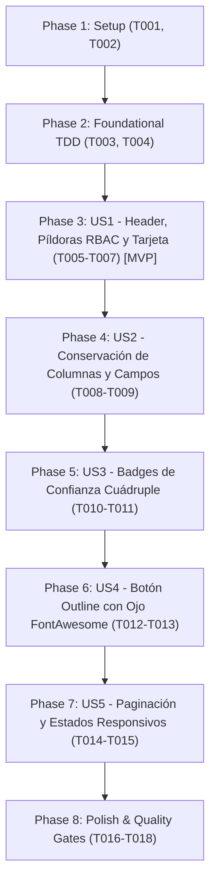

# Tasks: Rediseño Visual de la Vista de Auditoría Clínica

**Input**: Design documents from `specs/010-audit-view-redesign/`
**Prerequisites**: [plan.md](file:///c:/Users/owl_d/Documents/CURSOS/ORACLE_ONE_AI_FOR_TECH\Hackaton\G10-LATAM-TEAM-02-MediFlowI-Agente-IA\specs\010-audit-view-redesign\plan.md), [spec.md](file:///c:/Users/owl_d/Documents/CURSOS/ORACLE_ONE_AI_FOR_TECH\Hackaton\G10-LATAM-TEAM-02-MediFlowI-Agente-IA\specs\010-audit-view-redesign\spec.md), [research.md](file:///c:/Users/owl_d/Documents/CURSOS/ORACLE_ONE_AI_FOR_TECH\Hackaton\G10-LATAM-TEAM-02-MediFlowI-Agente-IA\specs\010-audit-view-redesign\research.md), [data-model.md](file:///c:/Users/owl_d/Documents/CURSOS/ORACLE_ONE_AI_FOR_TECH\Hackaton\G10-LATAM-TEAM-02-MediFlowI-Agente-IA\specs\010-audit-view-redesign\data-model.md), [contracts/ui-contracts.md](file:///c:/Users/owl_d/Documents/CURSOS/ORACLE_ONE_AI_FOR_TECH\Hackaton\G10-LATAM-TEAM-02-MediFlowI-Agente-IA\specs\010-audit-view-redesign\contracts\ui-contracts.md), [quickstart.md](file:///c:/Users/owl_d/Documents/CURSOS/ORACLE_ONE_AI_FOR_TECH\Hackaton\G10-LATAM-TEAM-02-MediFlowI-Agente-IA\specs\010-audit-view-redesign\quickstart.md)

---

## Phase 1: Setup (Shared Infrastructure)

**Purpose**: Preparación de importaciones de FontAwesome, variables de color y tipos auxiliares de auditoría.

- [X] T001 Verificar importaciones de iconos FontAwesome (`@fortawesome/react-fontawesome`, `@fortawesome/free-solid-svg-icons`) y clases de utilidad en `frontend/src/pages/Audit.tsx`
- [X] T002 [P] Definir tipos e interfaces auxiliares para la escala cuádruple de confianza y paginación en `frontend/src/types/auditView.types.ts`

---

## Phase 2: Foundational (Blocking Prerequisites - TDD)

**Purpose**: Funciones helper puras y suite base de pruebas unitarias que bloquean la implementación.

- [X] T003 [P] Implementar función utilitaria modular `getAuditConfidenceBadge` con los 4 rangos de color en `frontend/src/utils/auditConfidence.ts`
- [X] T004 [P] Crear suite de pruebas unitarias para validar rangos de confianza y renderizado en `frontend/src/pages/Audit.test.tsx`

**Checkpoint**: Base de pruebas y utilidades lista - Inicio de fases por historias de usuario.

---

## Phase 3: User Story 1 - Encabezado Central, Píldoras RBAC y Tarjeta Principal (Priority: P1) 🎯 MVP

**Goal**: Mostrar la cabecera centrada con el título exacto "Solicitudes de auditoría clínica", la barra superior de píldoras (`[ Enrutamiento | Historial | Solicitudes ]` con `Solicitudes` activa y control RBAC) y la tarjeta blanca redondeada (`rounded-3xl`) omitiendo el selector dropdown de filtros.

**Independent Test**: Cargar la pantalla de auditoría: verificar que el título principal es "Solicitudes de auditoría clínica", la barra de píldoras muestra `Solicitudes` resaltada y permite navegar a `/triaje` y `/documentos`, la tarjeta tiene contenedor blanco con esquinas redondeadas y no existe ningún dropdown en la cabecera.

### Tests for User Story 1

- [X] T005 [P] [US1] Añadir pruebas unitarias para validar el título "Solicitudes de auditoría clínica", la píldora activa `Solicitudes` y la ausencia de selector dropdown en `frontend/src/pages/Audit.test.tsx`

### Implementation for User Story 1

- [X] T006 [US1] Integrar la barra de píldoras de navegación superior con control RBAC y píldora `Solicitudes` activa en `frontend/src/pages/Audit.tsx`
- [X] T007 [US1] Maquetar el título centralizado exacto "Solicitudes de auditoría clínica" y el contenedor principal blanco tipo tarjeta (`rounded-3xl` con sombra suave) omitiendo el menú dropdown en `frontend/src/pages/Audit.tsx`

**Checkpoint**: User Story 1 completada (MVP de layout listo e independientemente verificable).

---

## Phase 4: User Story 2 - Conservación Integral de Columnas y Campos Clínicos (Priority: P1)

**Goal**: Conservar exactamente las mismas 6 columnas y campos existentes en `Audit.tsx` (`ID`, `Documento`, `Confianza`, `Motivo de Derivación`, `Fecha`, `Visualizar`) sin pérdida de información clínica.

**Independent Test**: Renderizar documentos de auditoría: constatar que la tabla exhibe las 6 columnas con sus datos originales vinculados (`item.documento_id`, `item.nombre_archivo`, confianza, motivo con icono, fecha y botón de acción).

### Tests for User Story 2

- [X] T008 [P] [US2] Añadir pruebas unitarias para verificar la presencia de las 6 columnas clínicas exactas en `frontend/src/pages/Audit.test.tsx`

### Implementation for User Story 2

- [X] T009 [US2] Reestructurar la tabla clínica con Tailwind CSS preservando estrictamente las 6 columnas y campos originales en `frontend/src/pages/Audit.tsx`

**Checkpoint**: User Story 2 completada (integridad de datos clínicos garantizada).

---

## Phase 5: User Story 3 - Badges de Confianza con Regla Cuádruple de Colores Institucionales (Priority: P2)

**Goal**: Asignar colores a los badges de confianza según la escala de 4 rangos: <25% rojo (`var(--error)`), 25-50% anaranjado (`var(--orange)`), 50-75% amarillo (`var(--warning)` / warning), y >75% verde (`var(--green)`).

**Independent Test**: Verificar filas con scores de 15%, 35%, 60% y 90%: comprobar que aplican respectivamente los estilos y variables rojo, naranja, amarillo y verde.

### Tests for User Story 3

- [X] T010 [P] [US3] Añadir pruebas unitarias para validar la aplicación de clases y colores en los 4 rangos de confianza en `frontend/src/pages/Audit.test.tsx`

### Implementation for User Story 3

- [X] T011 [US3] Integrar la función de badge cuádruple en la columna "Confianza" de la tabla de auditoría en `frontend/src/pages/Audit.tsx`

**Checkpoint**: User Story 3 completada (escala cromática de confianza operativa).

---

## Phase 6: User Story 4 - Botón de Revisión Outline con Icono de Ojo FontAwesome y Hover Azul (Priority: P2)

**Goal**: Implementar en la columna de acción botones outline con icono de ojo FontAwesome (`faEye`), que al hacer hover cambien el fondo a azul (`var(--primary)` / `#2C5282`) y el contenido a blanco puro (`#ffffff`), redirigiendo a `/auditoria/${documento_id}`.

**Independent Test**: Inspeccionar el botón de cada fila: verificar presencia del icono de ojo FontAwesome, estilo outline en reposo, transición a fondo azul con icono/texto blanco en hover, y navegación al hacer clic.

### Tests for User Story 4

- [X] T012 [P] [US4] Añadir pruebas unitarias para validar el botón outline, el icono de ojo FontAwesome y la navegación a `/auditoria/:id` en `frontend/src/pages/Audit.test.tsx`

### Implementation for User Story 4

- [X] T013 [US4] Implementar el botón outline con icono de ojo FontAwesome `faEye` y clases hover para fondo `var(--primary)` y texto blanco en `frontend/src/pages/Audit.tsx`

**Checkpoint**: User Story 4 completada (interacción y estilos del botón de acción verificados).

---

## Phase 7: User Story 5 - Controles de Paginación Visual y Estados de Carga/Vacío Responsivos (Priority: P3)

**Goal**: Incluir en el pie de la tarjeta un control visual de paginación numerada (`01`, `02`, etc.) y preservar los estados `Loading`, `ErrorMessage` y `EmptyState` con diseño 100% responsivo.

**Independent Test**: Validar la presencia del bloque de paginación en el pie de la tarjeta y comprobar la correcta visualización en pantallas reducidas con contenedor con scroll horizontal (`overflow-x-auto`).

### Tests for User Story 5

- [X] T014 [P] [US5] Añadir pruebas unitarias para validar el bloque de paginación y los estados de carga y vacío en `frontend/src/pages/Audit.test.tsx`

### Implementation for User Story 5

- [X] T015 [US5] Implementar el bloque de paginación estilizado en el pie de la tarjeta y el contenedor responsivo `overflow-x-auto` en `frontend/src/pages/Audit.tsx`

**Checkpoint**: User Story 5 completada (paginación visual y adaptabilidad completas).

---

## Phase 8: Polish & Quality Gates (Constitution & Test-First)

**Purpose**: Verificación de responsividad, cero regresiones y cumplimiento irrestricto de las compuertas de calidad.

- [X] T016 [P] Verificar responsividad en móvil (`sm`), tablet (`md`) y escritorio (`lg`) con Tailwind CSS en `frontend/src/pages/Audit.tsx`
- [X] T017 Ejecutar la suite completa de pruebas de frontend (`npm --prefix frontend run test`) garantizando 100% de tests en verde
- [X] T018 Ejecutar la compilación estricta de producción (`npm --prefix frontend run build`) certificando 0 errores de TypeScript

---

## Dependencies & Completion Order

---

## Parallel Execution Opportunities

- **T002** (`auditView.types.ts`) y **T003** (`auditConfidence.ts`) pueden desarrollarse en paralelo con **T004** (`Audit.test.tsx`).
- En cada historia de usuario, las tareas de pruebas (`[P]`) se escriben y ejecutan primero antes de la implementación de componentes, satisfaciendo el principio constitucional de **Test-First**.
- Las verificaciones finales de responsividad (**T016**) pueden revisarse en paralelo con la ejecución de suites automatizadas (**T017**, **T018**).
