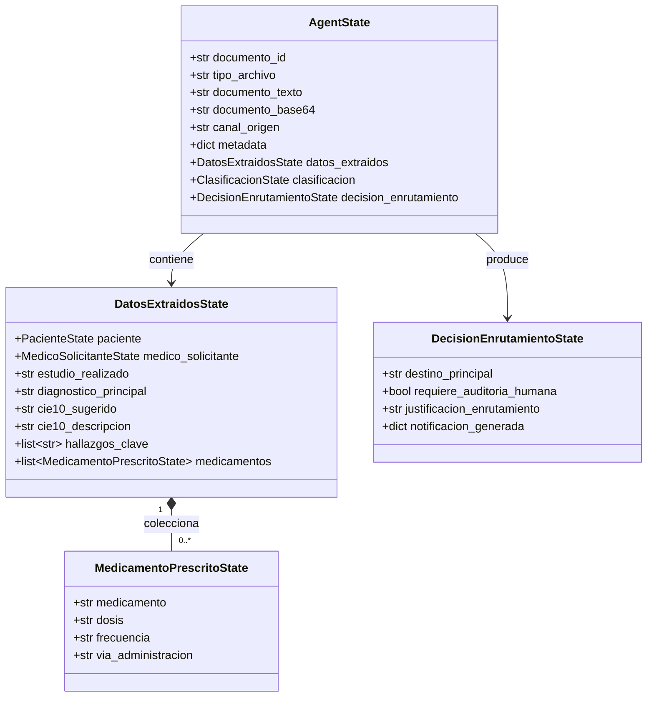

# Data Model: Extracción de Medicamentos Prescritos

**Feature**: `011-prescription-medication-extraction`  
**Date**: 2026-10-15  
**Status**: Final  

---

## 1. Diagrama de Relaciones de Entidades



---

## 2. Definición Detallada de Modelos

### A. `MedicamentoPrescritoState`

Representa una indicación farmacológica unitaria prescrita en una receta médica o informe clínico.

| Campo | Tipo | Obligatorio | Valor por Defecto | Descripción y Validaciones |
|---|---|---|---|---|
| `medicamento` | `str` | **Sí** | N/A | Nombre del principio activo o marca comercial (ej. `"Paracetamol"`, `"Amoxicilina"`). Debe tener longitud mínima de 1 carácter no vacío tras `.strip()`. |
| `dosis` | `str \| None` | No | `None` | Dosificación cuantitativa con unidad de medida clínica (ej. `"500 mg"`, `"10 ml"`, `"1 gota"`). |
| `frecuencia` | `str \| None` | No | `None` | Periodicidad, intervalo o pauta de administración (ej. `"cada 8 horas"`, `"1 vez al día"`, `"c/12h"`, `"SOS"`). |
| `via_administracion` | `str \| None` | No | `None` | Vía anatómica de administración farmacológica (ej. `"oral"`, `"intravenosa"`, `"subcutánea"`, `"tópica"`, `"oftálmica"`). |

```python
class MedicamentoPrescritoState(BaseModel):
    medicamento: str
    dosis: str | None = None
    frecuencia: str | None = None
    via_administracion: str | None = None
```

### B. `DatosExtraidosState` (Ampliación)

Se añade la colección tipada de medicamentos prescritos manteniendo los campos preexistentes:

```python
class DatosExtraidosState(BaseModel):
    paciente: PacienteState | None = None
    medico_solicitante: MedicoSolicitanteState | None = None
    estudio_realizado: str | None = None
    diagnostico_principal: str | None = None
    cie10_sugerido: str | None = None
    cie10_descripcion: str | None = None
    hallazgos_clave: list[str] = Field(default_factory=list)
    medicamentos: list[MedicamentoPrescritoState] = Field(default_factory=list)
```

- **Invariante**: Si el documento no posee medicamentos prescritos, `medicamentos` se inicializa como lista vacía `[]`, jamás `None`.

---

## 3. Reglas de Validación y Consolidación

1. **Extracción y Deserialización Defensiva**:
   - Cada elemento en el campo JSON `medicamentos` debe ser un objeto diccionario.
   - Si un elemento no contiene la clave `medicamento` o su valor es una cadena vacía/nula, el elemento se descarta defensivamente.
   - Los campos `dosis`, `frecuencia` y `via_administracion` se convierten a cadena limpia (`.strip()`) si contienen valor de texto, o `None` si son `null` o vacíos.

2. **Deduplicación entre Bloques**:
   - Al procesar documentos por fragmentos (`dividir_texto_en_bloques`), dos medicamentos se consideran duplicados si coinciden en la clave compuesta:
     $$\text{clave} = (\text{medicamento.lower()}, \text{dosis.lower()}, \text{frecuencia.lower()}, \text{via\_administracion.lower()})$$
   - Se preserva la primera ocurrencia encontrada en el orden de lectura.

3. **Interacción con Enrutamiento (`DecisionEnrutamientoState`)**:
   - `tiene_medicamentos = len(medicamentos) > 0`
   - Si `tiene_medicamentos == True` y `nivel != "Urgente"` y `score >= 0.75`:
     - El `destino_principal` se asigna a `"Farmacia_Hospitalaria"`.
     - Si alguno de los nombres en `medicamentos` pertenece a la lista de estupefacientes/controlados (`MEDICAMENTOS_CONTROLADOS`), se establece `requiere_auditoria_humana = True`. De lo contrario, `requiere_auditoria_humana = False`.
