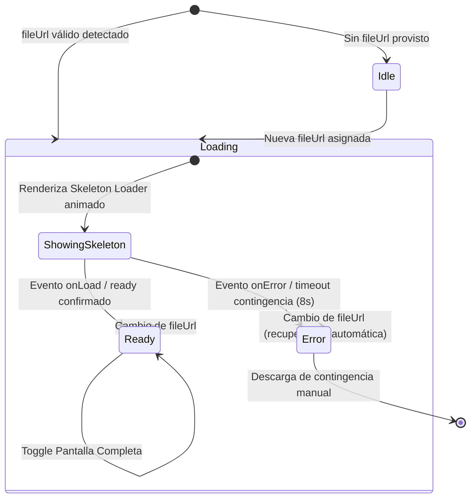

# Modelo de Datos y Estados: Visor Clínico Interactivo de Documentos

**Feature**: `013-clinical-pdf-viewer`
**Fecha**: 2026-10-18

Este documento especifica el modelo de datos reactivo, interfaces de TypeScript, estados de ciclo de vida y reglas de validación del componente `DocumentViewer`.

---

## 1. Entidades y Tipos TypeScript

### `DocumentViewerProps` (Contrato de Propiedades del Componente)

```typescript
export interface DocumentViewerProps {
  /** Nombre descriptivo del archivo clínico (ej. 'receta_20261018.pdf', 'estudio_rx.webp') */
  fileName?: string;
  /** URL accesible o Data URI del documento para visualización y descarga */
  fileUrl?: string;
  /** Altura mínima predeterminada del contenedor (por defecto: '520px') */
  minHeight?: string;
  /** Callback opcional invocado al cambiar el estado de pantalla completa */
  onFullScreenChange?: (isFullScreen: boolean) => void;
  /** Callback opcional ante errores irrecuperables de carga */
  onError?: (error: Error) => void;
}
```

### `ViewerLoadingState` (Máquina de Estados de Carga)

```typescript
export type ViewerLoadingState = 'idle' | 'loading' | 'ready' | 'error';
```

### `DocumentViewerState` (Estado Interno del Componente)

```typescript
export interface DocumentViewerState {
  /** Estado de carga del documento embebido */
  loadingState: ViewerLoadingState;
  /** Factor de escala actual (0.5 a 2.5, base: 1.0) */
  zoomLevel: number;
  /** Si el visor está ocupando toda la pantalla (API nativa o fallback CSS) */
  isFullscreen: boolean;
  /** Mensaje explicativo en caso de error o advertencia de visualización */
  errorMessage: string | null;
  /** Referencia a la última URL procesada para detectar cambios de archivo */
  lastLoadedUrl?: string;
}
```

---

## 2. Máquina de Estados y Transiciones



---

## 3. Reglas de Validación y Restricciones Clínicas

1. **Rango de Zoom**:
   - Escala mínima: `0.5` (50%).
   - Escala máxima: `2.5` (250%).
   - Incremento / Decremento por paso: `0.25` (25%).
   - Valor de restablecimiento: `1.0` (100%).
2. **Detección de Formato**:
   - PDF: Detección por extensión `.pdf` en `fileName` o tipo MIME `application/pdf`.
   - Imágenes Clínicas: Detección por extensiones `.webp`, `.png`, `.jpg`, `.jpeg`.
3. **Persistencia y Reset de Estado**:
   - Cuando la propiedad `fileUrl` cambia, el componente **DEBE** restablecer automáticamente `zoomLevel = 1.0`, reiniciar `loadingState = 'loading'` y limpiar cualquier `errorMessage`.
4. **Resiliencia Operativa**:
   - El estado de error **NUNCA** debe bloquear la interfaz de usuario ni cerrar el modal o pestaña donde se encuentra alojado el visor. Siempre debe ofrecer descarga directa y enlace alternativo.

