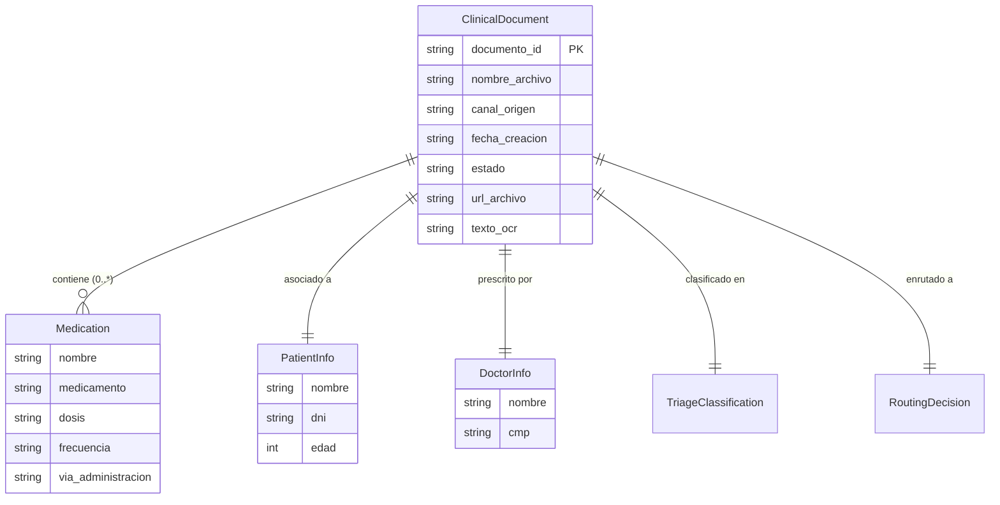
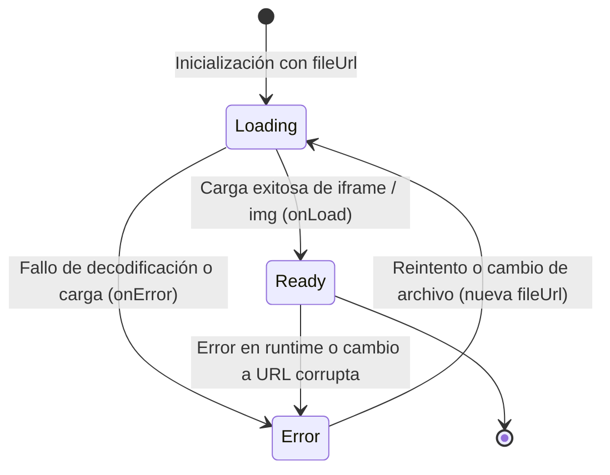

# Phase 1: Data Model — Prescripciones Médicas y Visor Clínico

**Feature**: [014-prescription-medication-viewer](spec.md)  
**Date**: 2026-10-20  
**Status**: Ready for Implementation  

---

## Entidades de Dominio

### 1. Medication (Entidad de Farmacoterapia)

Modela un medicamento prescrito individual extraído de una receta médica o informe clínico.

| Campo | Tipo | Requerido | Descripción | Reglas de Validación |
|---|---|:---:|---|---|
| `nombre` | `string` | No (opcional) | Nombre genérico o principio activo del fármaco | Sanitizado para prevención XSS |
| `medicamento` | `string` | No (opcional) | Alias o nombre comercial del fármaco | Sanitizado para prevención XSS |
| `dosis` | `string` | No (opcional) | Cantidad y unidad posológica (ej. "500 mg", "10 ml") | Formato texto libre o estructurado |
| `frecuencia` | `string` | No (opcional) | Intervalo o pauta horaria (ej. "Cada 8 horas por 7 días") | Formato texto descriptivo |
| `via_administracion` | `string` | No (opcional) | Vía clínica de suministro (ej. "Oral", "Intravenosa", "Tópica") | Insignia renderizada condicionalmente |

#### Normalización y Mapeo
```typescript
interface Medication {
  nombre?: string
  medicamento?: string
  dosis?: string
  frecuencia?: string
  via_administracion?: string
}
```

---

### 2. ClinicalDocument (Expediente Clínico Extendido)

Extensión de la entidad central de documentos clínicos con la colección de fármacos en `datos_extraidos`.



---

### 3. DocumentViewerState (Estado del Visor Clínico)

Modela el ciclo de vida de renderizado del visor reactivo `DocumentViewer.tsx`.



#### Atributos de Estado del Visor:
- `loadingState`: `'loading' | 'ready' | 'error'`
- `errorMessage`: Encabezado descriptivo unívoco (`string | null`).
- `detailedDescription`: Texto explicativo para accesibilidad y soporte de contingencia.
- `zoom`: Nivel de ampliación porcentual (`50%` a `200%`).
- `isExpanded`: Estado de modal a pantalla completa (`true | false`).
