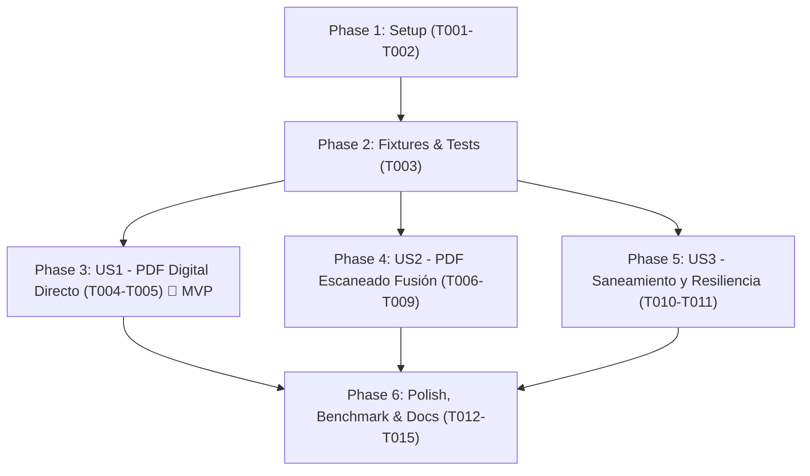

# Tasks: Pipeline Fusion para PDFs Escaneados e Híbridos (Tarea 2.9 / IA-09)

**Input**: Design documents from `specs/015-pipeline-fusion-scanned-pdf/`  
**Prerequisites**: [plan.md](./plan.md) (required), [spec.md](./spec.md) (required for user stories), [research.md](./research.md), [data-model.md](./data-model.md), [contracts/fusion-pdf-contract.md](./contracts/fusion-pdf-contract.md), [quickstart.md](./quickstart.md)  
**Referencia de Plan de Trabajo**: Tarea 2.9 (`plan de trabajo/PLAN_DE_TRABAJO_BACKEND_LANGGRAPH.md`)  
**Issue de GitHub**: [IA-09] #69 / PR #77  

**Organization**: Tasks are grouped by user story to enable independent implementation and testing of each story with a strict TDD approach.

## Format: `[ID] [P?] [Story] Description`

- **[P]**: Can run in parallel (different files, no dependencies)
- **[Story]**: Which user story this task belongs to (e.g., US1, US2, US3)
- Exact file paths are specified in every description

---

## Phase 1: Setup (Shared Infrastructure)

**Purpose**: Verificación de la infraestructura base de Pipeline Fusion proveniente de PR #77.

- [x] T001 Auditar disponibilidad de clases `ContextoTriaje` y `ResultadoFusionVision` en `backend/app/agent/fusion.py`
- [x] T002 [P] Auditar configuración de resiliencia y timeouts (`timeout=30`, `max_retries=2`) en `backend/app/services/llm_service.py`

---

## Phase 2: Foundational (Blocking Prerequisites)

**Purpose**: Preparación de fixtures y casos de prueba para discriminación de PDFs antes de la implementación de historias de usuario.

**⚠️ CRITICAL**: No user story work can begin until this phase is complete.

- [x] T003 [P] Crear fixtures para PDFs digitales (≥ 50 caracteres) y PDFs escaneados (< 50 caracteres) en `backend/tests/test_pipeline_fusion.py`

**Checkpoint**: Base de pruebas y fixtures lista. Las historias de usuario pueden implementarse de forma independiente.

---

## Phase 3: User Story 1 - Discriminación Inteligente y Extracción Inmediata de PDF Digital (Priority: P1) 🎯 MVP

**Goal**: Si el PDF tiene texto digital suficiente (≥ 50 caracteres clínicos útiles), extraer directamente con PyMuPDF en ~0.01s con método `TEXT_EXTRACTION` sin consumir llamadas de visión artificial.

**Independent Test**: Ejecutar prueba con PDF digital sintético y corroborar que `metodo_extraccion == "TEXT_EXTRACTION"`, latencia de ingesta < 50 ms y 0 llamadas al LLM de visión.

### Tests for User Story 1 (TDD) ⚠️

- [x] T004 [P] [US1] Escribir prueba unitaria que verifique que un PDF con texto digital suficiente (≥ 50 caracteres) se extrae de inmediato con `PyMuPDF` sin activar visión en `backend/tests/test_pipeline_fusion.py`

### Implementation for User Story 1

- [x] T005 [US1] Consolidar extracción vectorial directa en `_node_ingestion_convencional` asignando `metodo_extraccion = "TEXT_EXTRACTION"` y omitiendo visión en `backend/app/agent/nodes/ingestion.py`

**Checkpoint**: User Story 1 funcional de forma independiente (MVP listo). Los PDFs digitales procesan en milisegundos sin coste de visión.

---

## Phase 4: User Story 2 - Activación Automática de Pipeline Fusion en PDFs Escaneados (Priority: P2)

**Goal**: Si el texto digital es insuficiente (< 50 caracteres o solo membrete/título), activar automáticamente Pipeline Fusion rasterizando páginas en memoria a JPEG optimizado (< 350 KB) y ejecutando el pase único de Gemini Vision en < 7s.

**Independent Test**: Enviar un PDF escaneado (< 50 caracteres) y comprobar que el sistema rasteriza en memoria, optimiza la imagen a < 350 KB, invoca `_PROMPT_VISION_FUSION`, puebla `ContextoTriaje` y cortocircuita los nodos `extraction` y `classification`.

### Tests for User Story 2 (TDD) ⚠️

- [x] T006 [P] [US2] Escribir pruebas unitarias para la detección de PDF escaneado (< 50 caracteres), rasterización en memoria y activación de `ContextoTriaje` en `backend/tests/test_pipeline_fusion.py`

### Implementation for User Story 2

- [x] T007 [US2] Implementar la función de rasterizado y optimización en memoria `_rasterizar_pdf_a_fusion_image` utilizando `fitz` e `image_optimizer.py` en `backend/app/agent/nodes/ingestion.py`
- [x] T008 [US2] Extender el enrutador de `node_ingestion` en `backend/app/agent/nodes/ingestion.py` para canalizar PDFs escaneados hacia `_node_ingestion_fusion`
- [x] T009 [US2] Verificar que `ContextoTriaje.fusion_resultado` aplique cortocircuito reactivo en `backend/app/agent/nodes/extraction.py` y `backend/app/agent/nodes/classification.py` para PDFs escaneados

**Checkpoint**: User Story 2 funcional: PDFs escaneados e híbridos resuelven en un solo viaje de red en < 7 segundos.

---

## Phase 5: User Story 3 - Saneamiento de Memoria en LangGraph y Resiliencia Clínica (Priority: P3)

**Goal**: Garantizar que `documento_base64` se libere (`None`) al culminar la ingesta en todos los casos y degradar de forma segura a `FALLBACK_AUDIT` ante PDFs corruptos o fallos de visión.

**Independent Test**: Verificar que `state["documento_base64"] is None` tras procesar PDFs escaneados y que un PDF dañado deriva a `FALLBACK_AUDIT` sin romper la consola.

### Tests for User Story 3 (TDD) ⚠️

- [x] T010 [P] [US3] Escribir pruebas unitarias que validen la purga de `documento_base64 = None` y la derivación a `FALLBACK_AUDIT` ante PDFs dañados en `backend/tests/test_pipeline_fusion.py`

### Implementation for User Story 3

- [x] T011 [US3] Asegurar la liberación de `documento_base64 = None` y la captura limpia de excepciones con derivación a `FALLBACK_AUDIT` en la ruta de PDFs escaneados de `backend/app/agent/nodes/ingestion.py`

**Checkpoint**: User Story 3 funcional: memoria protegida contra fugas y degradación resiliente.

---

## Phase 6: Polish & Cross-Cutting Concerns

**Purpose**: Verificación de calidad, suite completa en verde, benchmark y sincronización documental.

- [x] T012 Ejecutar la suite completa de pruebas unitarias (`backend/.venv/bin/pytest backend/tests/test_pipeline_fusion.py backend/tests/test_pipeline_fusion_benchmark.py -v`)
- [x] T013 [P] Validar el cumplimiento del benchmark de latencia p95 < 8s ejecutando `infrastructure/scripts/benchmark_pipeline_fusion.py`
- [x] T014 [P] Sincronizar el estado final de la Tarea 2.9 en `plan de trabajo/PLAN_DE_TRABAJO_BACKEND_LANGGRAPH.md`
- [x] T015 Validar el flujo extremo a extremo siguiendo la guía en `specs/015-pipeline-fusion-scanned-pdf/quickstart.md`

---

## Dependencies & Execution Order

### Phase Dependencies

- **Setup (Phase 1)**: Sin dependencias - audita módulos base.
- **Foundational (Phase 2)**: Depende de Phase 1 - BLOQUEA las historias de usuario.
- **User Stories (Phase 3+)**: Dependen de Phase 2.
  - US1 (P1): Implementa y prueba la Regla 1 (PDF digital).
  - US2 (P2): Implementa y prueba la Regla 2 (PDF escaneado con fusión).
  - US3 (P3): Implementa saneamiento de memoria y manejo de errores.
- **Polish (Phase 6)**: Depende de que US1, US2 y US3 estén implementadas.

### User Story Dependencies



---

## Parallel Opportunities

- **Setup**: `T001` y `T002` pueden auditarse en paralelo.
- **Pruebas (TDD)**: Las pruebas unitarias `T004` (US1), `T006` (US2) y `T010` (US3) pueden desarrollarse en paralelo tras completar `T003`.
- **Polish**: `T013` (benchmark) y `T014` (documentación) pueden ejecutarse en paralelo.

---

## Parallel Example: User Story 1 & User Story 2

```bash
# Ejecutar en paralelo la preparación de pruebas para US1 y US2:
backend/.venv/bin/pytest backend/tests/test_pipeline_fusion.py -k "test_pdf_digital"
backend/.venv/bin/pytest backend/tests/test_pipeline_fusion.py -k "test_pdf_escaneado"
```

---

## Implementation Strategy

### MVP First (User Story 1 Only)

1. Completar Phase 1 (Setup) y Phase 2 (Foundational Fixtures).
2. Completar Phase 3 (User Story 1): Test `T004` ➔ Implementación `T005`.
3. **VALIDAR**: Ejecutar `pytest backend/tests/test_pipeline_fusion.py -k "test_pdf_digital"` para confirmar discriminación < 50 ms.

### Incremental Delivery

1. Setup + Foundational listos.
2. Entregar US1 (PDFs Digitales) ➔ cero latencia en informes nativos.
3. Entregar US2 (PDFs Escaneados con Pipeline Fusion) ➔ pase único en < 7s.
4. Entregar US3 (Saneamiento de memoria y fallback) ➔ estabilidad de producción.
5. Ejecutar benchmark p95 y certificar la Tarea 2.9 (IA-09) en verde.
