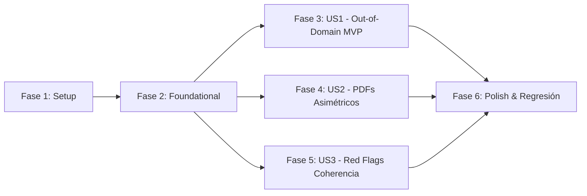

# Tasks: Guardrails de Seguridad Clínica (Filtro Fuera de Dominio, PDFs Asimétricos y Validación Cruzada)

**Input**: Design documents from `/specs/016-clinical-safety-guardrails/`  
**Prerequisites**: [plan.md](file:///home/wigsdev/GitHub/mediflow/specs/016-clinical-safety-guardrails/plan.md), [spec.md](file:///home/wigsdev/GitHub/mediflow/specs/016-clinical-safety-guardrails/spec.md), [research.md](file:///home/wigsdev/GitHub/mediflow/specs/016-clinical-safety-guardrails/research.md), [data-model.md](file:///home/wigsdev/GitHub/mediflow/specs/016-clinical-safety-guardrails/data-model.md), [contracts/](file:///home/wigsdev/GitHub/mediflow/specs/016-clinical-safety-guardrails/contracts/guardrails.contract.json)  
**Metodología**: TDD Estricto conforme al Principio Constitucional I (Pruebas primero en rojo -> Implementación en verde -> Refactorización).  
**Organización**: Las tareas están ordenadas por User Story para permitir entregas e incrementos independientes de valor clínico.

---

## Format: `- [ ] [ID] [P?] [Story] Description with file path`

- **[P]**: Ejecutable en paralelo (archivos independientes, sin dependencias bloqueantes)
- **[Story]**: Identificador de User Story ([US1], [US2], [US3])
- Rutas de archivo exactas en cada descripción

---

## Phase 1: Setup (Estructuras de Datos y Catálogo)

**Propósito**: Inicialización del catálogo clínico determinista y extensión de metadatos de estado.

- [x] T001 [P] Crear catálogo inmutable de señales de alarma y modelos de guardrail en backend/app/agent/clinical_guardrails.py
- [x] T002 [P] Declarar campos de metadatos de trazabilidad de guardrails en backend/app/agent/state.py

---

## Phase 2: Foundational (Arnés de Pruebas Unitarias)

**Propósito**: Generadores de documentos sintéticos para pruebas adversarias (documentos ajenos, PDFs asimétricos, red flags).

- [x] T003 [P] Crear archivo de pruebas unitarias y generadores de casos adversarios en backend/tests/test_clinical_guardrails.py

---

## Phase 3: User Story 1 - Filtro Fuera de Dominio (Out-of-Domain Gate) (Priority: P1) 🎯 MVP

**Objetivo**: Interceptar documentos clasificados como `No_Clinico`, `Otro` o `Desconocido`, prohibiendo taxativamente su derivación a colas de rutina o emergencia y canalizándolos a `Cola_Revision_Ambigua` con `status = "pendiente_auditoria"` y `requiere_auditoria_humana = True`.

**Test Independiente**: Enviar documentos sintéticos no médicos (folletos, afiches, facturas comerciales) y validar que el 100% son retenidos para auditoría humana en `Cola_Revision_Ambigua` con motivo `"fuera_de_dominio_clinico"`.

### Pruebas para User Story 1 (TDD - Escribir primero en rojo)
- [x] T004 [P] [US1] Escribir pruebas unitarias de intercepción fuera de dominio en backend/tests/test_clinical_guardrails.py

### Implementación para User Story 1
- [x] T005 [US1] Implementar filtro fuera de dominio en backend/app/agent/nodes/routing.py bloqueando enrutamiento a colas operativas
- [x] T006 [US1] Inyectar metadatos y motivo de retención fuera_de_dominio_clinico en backend/app/agent/nodes/routing.py

**Checkpoint US1**: El MVP de contención de documentos ajenos está 100% operativo y testeado de forma independiente.

---

## Phase 4: User Story 2 - Inspección Página por Página de PDFs Asimétricos (Priority: P2)

**Objetivo**: Evaluar individualmente cada página de un PDF multipágina. Si una página carece de texto digital suficiente (< 50 caracteres) o incluye imágenes incrustadas de urgencias o recetas, rasterizar y procesar visualmente hasta 3 páginas en memoria, consolidando su información con los folios digitales.

**Test Independiente**: Procesar un PDF de 2 páginas (página 1 digital de control sano, página 2 escaneada con orden de urgencia o receta) y verificar que los hallazgos de la página escaneada son extraídos e integrados en el triaje sin omisiones.

### Pruebas para User Story 2 (TDD - Escribir primero en rojo)
- [x] T007 [P] [US2] Escribir pruebas unitarias de ingesta de PDFs asimétricos en backend/tests/test_clinical_guardrails.py

### Implementación para User Story 2
- [x] T008 [US2] Implementar evaluador de folios individuales _evaluar_paginas_pdf en backend/app/agent/nodes/ingestion.py
- [x] T009 [US2] Implementar flujo de rasterizado adaptativo de hasta 3 folios visuales y fusión en memoria en backend/app/agent/nodes/ingestion.py
- [x] T010 [US2] Asegurar liberación estricta de memoria documento_base64 = None y metadatos de PDF asimétrico en backend/app/agent/nodes/ingestion.py

**Checkpoint US2**: Los PDFs multipágina asimétricos e híbridos son procesados sin pérdida de información clínica anexa.

---

## Phase 5: User Story 3 - Validación Cruzada y Matriz de Red Flags (Priority: P3)

**Objetivo**: Realizar validación semántica cruzada determinista. Si los hallazgos o diagnóstico contienen afecciones de riesgo vital (TEP, IAM, Shock, ACV) pero el modelo asignó prioridad "Rutina", anular la confianza a `0.0` y forzar derivación a auditoría médica prioritaria en `Cola_Revision_Ambigua`.

**Test Independiente**: Procesar un caso con diagnóstico de TEP o IAM simulando clasificación "Rutina", verificando que la confianza cae a 0.0 y se deriva forzosamente a auditoría con motivo `"discordancia_critica_red_flags"`.

### Pruebas para User Story 3 (TDD - Escribir primero en rojo)
- [x] T011 [P] [US3] Escribir pruebas unitarias de validación cruzada y anulación de confianza en backend/tests/test_clinical_guardrails.py

### Implementación para User Story 3
- [x] T012 [US3] Implementar evaluador de coherencia semántica con filtrado de negaciones en backend/app/agent/clinical_guardrails.py
- [x] T013 [US3] Integrar calibración de confianza y desplome a 0.0 por red flags en backend/app/agent/nodes/confidence.py
- [x] T014 [US3] Configurar enrutamiento forzado y estado pendiente_auditoria por discordancia crítica en backend/app/agent/nodes/routing.py

**Checkpoint US3**: Las subestimaciones graves de riesgo vital son interceptadas deterministamente con confianza 0.0.

---

## Phase 6: Polish, Contratos & Verificación de Regresión

**Propósito**: Validación de contratos JSON, rendimiento y verificación de 0 regresiones en todo el agente.

- [x] T015 [P] Validar cumplimiento del contrato specs/016-clinical-safety-guardrails/contracts/guardrails.contract.json en backend/tests/test_clinical_guardrails.py
- [x] T016 Ejecutar suite completa de regresión pytest en backend/tests/ asegurando 100% tests en verde sin mutar mediflow_dev

---

## Dependencias de User Stories y Orden de Ejecución

- **MVP Recomendado**: Implementar y validar Fase 1 a Fase 3 (US1).
- **Paralelismo**: Una vez completada la Fase 2, las pruebas de US1, US2 y US3 pueden redactarse en paralelo.
